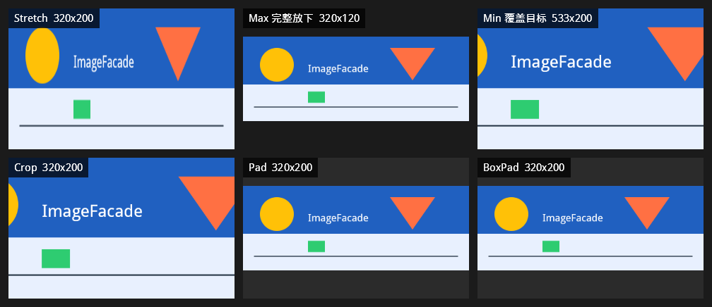
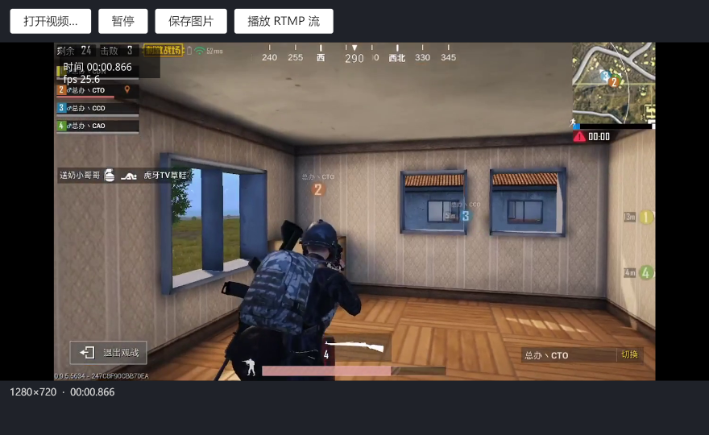
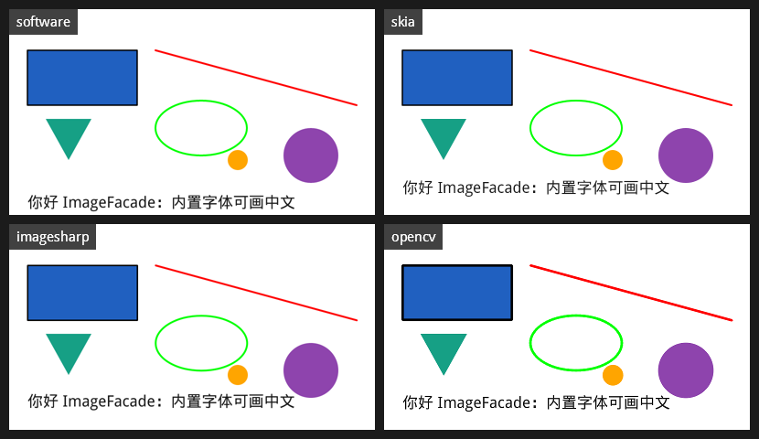
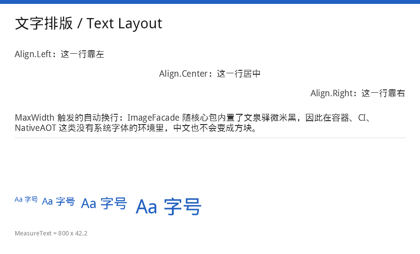
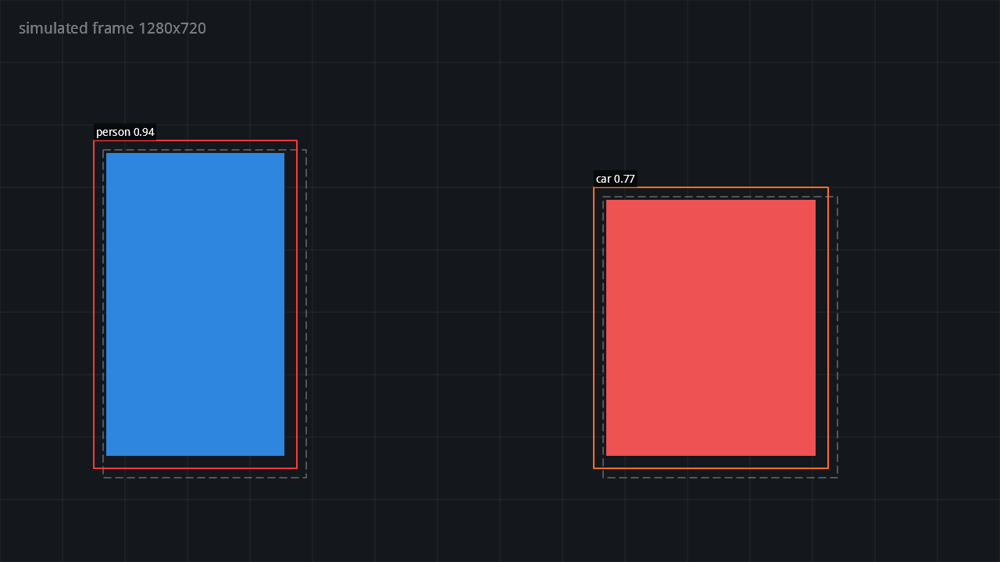
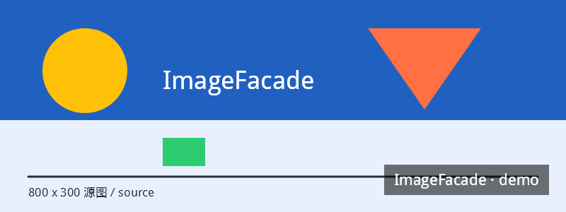
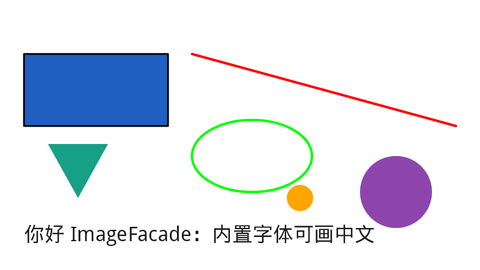
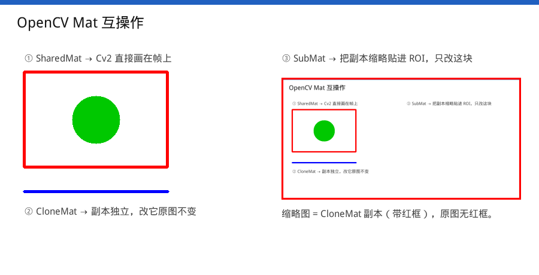
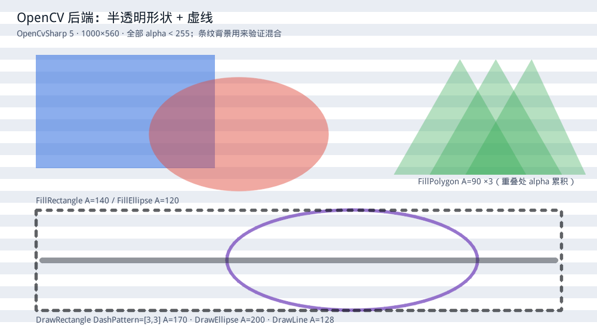

<div align="center">

# ImageFacade

**一套与后端无关的图像处理 API**。换一行构造代码，就能在 SkiaSharp / OpenCvSharp / ImageSharp / 纯托管软渲染之间切换，其余代码一个字都不用改。

<p>
  <a href="https://www.nuget.org/packages/Sevencat.ImageFacade"></a>
  <a href="https://www.nuget.org/packages/Sevencat.ImageFacade"></a>
  
  
  
  
</p>

<p>
  <a href="https://www.nuget.org/packages/Sevencat.ImageFacade">Sevencat.ImageFacade</a> ·
  <a href="https://www.nuget.org/packages/Sevencat.ImageFacade.SdcbSimdCodecs">SdcbSimdCodecs</a> ·
  <a href="https://www.nuget.org/packages/Sevencat.ImageFacade.SkiaSharp">SkiaSharp</a> ·
  <a href="https://www.nuget.org/packages/Sevencat.ImageFacade.SimdSkia">SimdSkia</a> ·
  <a href="https://www.nuget.org/packages/Sevencat.ImageFacade.Avalonia.SimdAIO">Avalonia.SimdAIO</a> ·
  <a href="https://www.nuget.org/packages/Sevencat.ImageFacade.Avalonia.Win64Aio">Avalonia.Win64Aio</a> ·
  <a href="https://www.nuget.org/packages/Sevencat.ImageFacade.ImageSharp">ImageSharp</a> ·
  <a href="https://www.nuget.org/packages/Sevencat.ImageFacade.ImageSharp2">ImageSharp2</a> ·
  <a href="https://www.nuget.org/packages/Sevencat.ImageFacade.OpenCvSharp">OpenCvSharp</a> ·
  <a href="https://www.nuget.org/packages/Sevencat.ImageFacade.OpenCvSharp5">OpenCvSharp5</a>
</p>

</div>



---

## 示例：Avalonia 播放器（SimdSkia + FFmpeg.AutoGen）

`samples/ImageFacade.AvaloniaDemo` 是一条端到端链路：FFmpeg.AutoGen 解出裸帧 → ImageFacade 在帧上叠时间和 fps → 写进 Avalonia 的 `WriteableBitmap`；窗口用 `SimdSkia.Avalonia.Desktop` 渲染，全程不引 SkiaSharp。播放本身一帧都不编解码；只有「保存图片」按钮额外引了 `ImageFacade.SdcbSimdCodecs` + `Sdcb.SimdCodecs.Png`（不想引的话见 [保存一帧](#保存一帧两条路选一条) 的 B 方案）。

```powershell
# 1. 原生库：FFmpeg.AutoGen 只是绑定，DLL 由运行环境提供。
#    把 ffmpeg 的 bin 目录里 avcodec / avformat / avutil / swscale 等 DLL 放到程序目录，
#    或设置 FFMPEG_HOME 指向该 bin 目录。
$env:FFMPEG_HOME = 'C:\ffmpeg\bin'

# 2. 构建并运行，点「打开视频…」选一个本地文件
dotnet run --project samples/ImageFacade.AvaloniaDemo

# 3. 直接带一个文件启动，省掉文件对话框
dotnet run --project samples/ImageFacade.AvaloniaDemo -- --open D:\clips\demo.mp4

# 4. 无图形会话时自检解码 + HUD 合成（结果写进输出目录的 decode-check.log，退出码表示成败）
dotnet run --project samples/ImageFacade.AvaloniaDemo -- --decode-check D:\clips\demo.mp4
```



上图是点「播放 RTMP 流」后截的窗口：那个按钮直接打开 `rtmp://liteavapp.qcloud.com/live/liteavdemoplayerstreamid`（腾讯云直播的公开 demo 源）。网络源和本地文件走同一条解码路径，唯一的多余设置是给 `avformat_open_input` 传 `rw_timeout`（5 秒），否则服务器不可达时解码线程会卡在 `av_read_frame` 里退不出来。

- 界面在 `MainWindow.axaml`，逻辑在 `MainWindow.axaml.cs`。
- 后台解码线程按 PTS 节流，`sws_scale` 直接把 YUV 转成预乘 Rgba32 写进帧池里那块 `FacadeImage` 的画布缓冲；UI 线程用 `DispatcherTimer` 取最新帧，`CopyPixelsTo` 写进 `WriteableBitmap`；分辨率变化时重建位图与帧池。
- HUD 在 `FrameComposer` 里用核心光栅完成：帧本身就是画布，`FillRectangle` / `DrawText` 直接画在解码输出上，再 `CopyPixelsTo(framebuffer.Address, framebuffer.RowBytes, Rgba32)` 写进 `WriteableBitmap` —— 每帧只有这一趟全帧搬运。
- 窗口底部显示当前尺寸与播放时间。
- 根容器必须给一个**不透明的 `Background`**。这跟渲染后端无关：Avalonia 12.1.5 在「窗口背景不透明 + 根 Panel 的 `Background` 为 `null` 或 `Transparent`」时，`Button` 这类带模板的控件会整块不绘制（官方 Skia 后端同样复现），`TextBlock`、`Border` 不受影响。给个不透明色即可，`Transparent` 不管用。

### 一帧的旅程：FFmpeg → ImageFacade → SimdSkia

整条链路只有**一次像素格式转换**（`sws_scale`）、**一次跨线程交接**（换引用）和**一次全帧搬运**（写进位图），中间不经过任何 `Bitmap` / `SKBitmap` / `byte[]` 的额外拷贝：

```text
FFmpeg 解码线程（VideoPlayer.Run）              UI 线程（DispatcherTimer，15 ms）
─────────────────────────────────              ──────────────────────────────
av_read_frame → packet
  → avcodec_send_packet / receive_frame
  → AVFrame（yuv420p / nv12 …）
  → RentFrame：从帧池借一块 FacadeImage
  → sws_scale 直写它的画布缓冲（预乘 Rgba32）
        │
        │  _pending 换引用（不拷贝）
        └────────── TryTakeFrame ──────────────►  WriteableBitmap.Lock()
                                                   → ILockedFramebuffer.Address
                                                   → FillRectangle + DrawText（HUD 就地画）
                                                   → CopyPixelsTo(Address)（预乘 → 直通）
                                                   → InvalidateVisual()
                        ◄────── ReturnFrame ──────  （帧还给池，下轮被 sws 覆盖）
```

| 步骤 | 谁在做 | 每帧的代价 |
|---|---|---|
| 解码 + `sws_scale` 成 RGBA | FFmpeg 原生库 | 一次整帧转换，直接写进池里那块画布 |
| 交接 `FacadeImage` | `VideoPlayer` | 换引用，0 拷贝 |
| `Lock()` 拿位图内存 | Avalonia / SimdSkia | 0 拷贝，直接给出像素地址 |
| HUD（矩形 + 两行字） | ImageFacade 光栅 | 微秒级，就地改画布 |
| `CopyPixelsTo(Address)` | ImageFacade 光栅 | 一次预乘 → 直通写回位图，全帧唯一的一次搬运 |
| 上屏 | SimdSkia | 位图提交为纹理（后端内部） |

三个关键点：

1. **分配只发生在拿到一个新尺寸的第一帧**：帧池按当前分辨率一次建满（`PoolSize` 块），此后每帧只是把池里的帧借出、写满、换引用、归还，链路侧不再 `new` 任何像素缓冲。
2. **帧池的作用是跳帧，不是攒帧**：解码比 UI 快时（直播 / 高帧率源），池里没有空闲帧就让 `RentFrame` 返回 `null`，这一帧**连 `sws_scale` 都不进**，直接丢掉——省掉缩放开销，也不会越积越多把延迟越拉越大。
3. **画布和位图都只建一次**：分辨率变化才重建。`CopyPixelsTo` 覆盖位图的同一块内存，所以每帧没有 `new`。

### 保存一帧：三条路，选一条

「保存图片」按钮保存的是**当前显示的画面**（视频 + HUD）。不能直接存帧池里那张 `FacadeImage`：UI 渲染完就把它归还了，解码线程随时会用下一帧覆盖。所以取的是已经 `CopyPixelsTo` 进 `WriteableBitmap` 的那一份，有三种存法（前两种要编解码，后一种不要）：

**A. Sdcb 软后端（demo 里用的这条）**——把位图导回一张软后端画布再编码：

```csharp
// 启动时注册一次 PNG
ImageBackendBase.RegisterCodec(ImageFormat.Png, PngImageDecoder.Registration, PngImageEncoder.Registration);

using var engine = new ImageEngine(new SoftwareBackend());
FacadeImage canvas = engine.Create(width, height, Rgba32.Black);   // 只建一次，且只在保存时用

using ILockedFramebuffer fb = bitmap.Lock();
canvas.ImportPixels(new ReadOnlySpan<byte>((void*)fb.Address, fb.RowBytes * height), fb.RowBytes);
canvas.SavePng("frame.png");       // 直接编码，不需要中转缓冲
```

这张画布**不参与逐帧渲染**（渲染用的是帧池里那块），只在保存时把画面搬进来一次。

`SoftwareBackend` 的绘制 / 像素读写由 `ImageBackendBase` 直接转给核心光栅，和 `new ImageEngine()` 是同一份实现；编解码则挂在这个后端上。所以**画布自己就能存**，不必"核心光栅画、另一个引擎存"那样搬一次像素。编码时内部只从 `PixelBufferPool`（4 MiB 上限）租一次缓冲，960×720（2.7 MB）能命中复用。

**A′. 换成 SimdSkia 后端：连这一趟导入都能省**——`WriteableBitmap` 的内存本来就是 RGBA32（demo 里创建时就指定了 `Rgba8888`），
`SimdSkiaBackend` 能直接接管它，不用先 `ImportPixels` 进画布：

```csharp
using var engine = new ImageEngine(new SimdSkiaBackend());   // PNG 编解码自带，不用 RegisterCodec

using ILockedFramebuffer fb = bitmap.Lock();
using FacadeImage frame = engine.FromPixels(
    fb.Address, width, height, fb.RowBytes, PixelFormat.Rgba32, wrap: true);

frame.SavePng("frame.png");       // 直接编码位图那块内存，一个字节都不搬
```

实测（96×64）：`IsZeroCopy == true`，编码结果与位图内存**逐字节一致**——包括半透明像素（`A=128` 原样回来，
因为这里是直通 → 直通，没有预乘往返）。两个前提：位图必须是 RGBA 顺序（`Bgra8888` 会让 wrap 退化，只能拷贝导入）；
`fb` 必须在 `frame.Dispose()` 之后才能解锁 / 释放，否则图还在用一块已经还回去的内存。

> **原来的 `ImportPixels` 那一行不能直接改成 `wrap: true`**，原因有三条：
> `ImportPixels` 只有 `ReadOnlySpan<byte>` 一个重载、**没有 `wrap` 参数**（span 是只读视图，语义上就不该被写）；
> wrap 是 `FromPixels(IntPtr, ..., wrap: true)` 的参数，且只有 SimdSkia 系列后端真正支持；
> 更要紧的是 `canvas` 是 `Create` 出来的常驻画布，**没有"外部缓冲"可接管**——它只能被写入，不能被替换成别人的内存。
> 想省掉这一趟，就得换成 A′：用 `FromPixels(..., wrap: true)` 从位图内存直接建帧（一次性，不常驻）。

**B. Avalonia 主包自带的编码器**——一个编解码包都不引：`WriteableBitmap` 已经是画好 HUD 的那一帧，直接交给 Avalonia 写盘即可（`MainWindow.SaveFrameWithAvalonia`，demo 里保留作示例、默认不调用）。

| | A. Sdcb 软后端 | A′. SimdSkia `wrap: true` | B. Avalonia `Bitmap.Save` |
|---|---|---|---|
| 额外依赖 | `ImageFacade.SdcbSimdCodecs` + `Sdcb.SimdCodecs.Png` | `ImageFacade.SimdSkia` 或 `ImageFacade.Avalonia.SimdAIO`（二选一，编解码自带） | 无 |
| 数据来源 | `WriteableBitmap` 像素（导入画布后编码） | `WriteableBitmap` 像素（**零拷贝**，直接编码） | `WriteableBitmap` 像素 |
| 像素搬运 | 一次整帧导入（直通 → 预乘） | 无 | 无 |
| 可控项 | `SaveOptions`（压缩级别 / 元数据），可换 JPEG / WebP / BMP… | 同 A（`SaveOptions`，格式取决于后端能力） | 只有后端默认值 |
| 不注册 codec 时 | `Load` / `Save` 抛 `FeatureNotSupportedException` | 不涉及（后端自带编码） | 照常可用 |

三种存法写出来的都是 960×720、含 HUD 的 PNG（同一个画面在 A 与 B 上分别约 420 KB / 400 KB；压缩实现不同，体积略有差异）。

命令行也能直接走这条路径（窗口摆到屏幕外，不抢前台）：

```powershell
dotnet run --project samples/ImageFacade.AvaloniaDemo -- --open D:\clips\demo.mp4 --save-frame D:\out\frame.png
# --shot D:\out\ui.png 则连窗口一起截（RenderTargetBitmap），用于验证界面
```

### 内存：链路侧零分配，曲线是窄幅锯齿

**播放过程中不分配像素缓冲。** 唯一的分配点是「拿到一个新尺寸的第一帧」：帧池按该分辨率一次建满 `PoolSize` 块 `FacadeImage`，之后每帧只是借出、写满、换引用、归还：

| 环节 | 创建时机 | 之后每帧做什么 |
|---|---|---|
| 帧池（`PoolSize` 块 `FacadeImage`） | 新分辨率的首帧，一次建满 | 借出 → `sws_scale` 覆盖写 → 换引用 → 归还；不 `new`、不复制 |
| `WriteableBitmap` | 分辨率变化时 `new` | `Lock()` 后由 `CopyPixelsTo` 直接写进去 |
| 保存用的软后端画布（`FrameComposer`） | 第一次保存时 `Create` | 只在保存时 `ImportPixels` 一次，与逐帧路径无关 |

前两项就是每帧会走过的全部路径。960×720、约 30 fps 连跑 35 秒（`--mem` 每 2 秒采一行；把参数换成 `--mem-gc` 会在每次采样前强制做一次完全回收 + 压缩，用来区分「垃圾还没回收」和「真的留住了」）：

| 指标 | 采样区间 |
|---|---|
| fps | 29.4 ~ 30.7 |
| 托管堆 | 69.7 ~ 89.9 MB |
| LOH | 56.1 ~ 69.3 MB |
| 工作集 | 247 ~ 261 MB |

曲线是**窄幅锯齿**而不是台阶：GC 一过就落回基线，35 秒里没有任何单向爬升，也没有"越播越慢"。

换成 `--mem-gc` 跑两分钟（70 个采样点），曲线更直白：前 12 秒 heap 从 34.8 爬到 42.0 MB、committed 从 43.0 到 48.3 MB，这是帧池 / 位图 / 字体与纹理的一次性建仓；之后 108 秒堆量**一条直线** —— heap 41.7 MB、LOH 30.5 MB、committed 48.3 MB 全部不动，工作集在 180 ± 1 MB 之间摆动，fps 28.6 ~ 31.2。每次采样前都做过阻塞式全回收，压回同一个数就说明没有东西被留住；累计分配 223 MB（约 1.2 MB/s）全是 Gen0 短命对象（拼接字符串、画刷、排版中间量），下一轮就被收掉。

怀疑"内存一直在涨"时按 `heap` / `loh` / `ws` 三列分开看，`--mem-gc` 那一行还多了 `frag` 和 `committed`：

| 现象 | 结论 |
|---|---|
| `heap` 涨，GC 后回落同一基线 | 正常锯齿，垃圾只是还没轮到回收 |
| `loh` 单调上升不回落 | 有 >4 MiB 的缓冲在反复新分配（`PixelBufferPool` 上限 4 MiB，1080p 整帧 8 MB 每次新分配、归还时丢弃） |
| `heap` 平稳而 `ws` / `priv` 线性涨 | 渲染后端侧：SimdSkia 每帧把位图提交成纹理（约 2.4 MB/帧），增长不是像素缓冲 |

把 `VideoView.InvalidateVisual()` 临时注释掉再跑，分配速率掉到 0.9 MB/s、LOH 恒定 44.2 MB——说明**解码、HUD 合成、写位图这一侧已经零分配**，剩下的波动全部来自上屏那一步。

SimdSkia 在这条链路里的好处很直接：

- **没有原生对象要管**：不需要 `SKBitmap` / `SKSurface` / `SKImage`，也不需要 `Switch` 到 UI 线程做 `SKCanvas.DrawBitmap`；一整帧的托管表示就是那张 `WriteableBitmap`，不再有第二份"显示用"的缓冲。
- **没有原生 DLL**：不引 `SkiaSharp` / `SkiaSharp.NativeAssets.*`，纯托管，`dotnet publish` 出来就是全部，部署与 AOT 都省事。
- **波动可预期**：链路上的分配是 0，渲染侧的量级固定，所以内存曲线稳定在几十 MB 的窄带里，不随时长增长。

如果连每帧那次纹理提交也想省掉，把 `UseSimdSkiaDesktop()` 换成官方的 `UsePlatformDetect()` 即可：解码、HUD 合成、写位图一行都不用改，官方 Skia 后端直接复用位图内存。早期用同一份代码对照测过（960×720、60 秒）：托管堆 12.5 MB 恒定、LOH 10.5 MB（就是那 4 块帧池）、分配 0.2 MB/s、GC 1 次；而 SimdSkia 这条路上托管堆在 70~90 MB 来回、分配约 70 MB/s（就是上面那次 35 秒采样）。差别全在绘制路径——**要零原生依赖 + AOT 选 SimdSkia，要极致的托管内存曲线选官方后端**，这正是把渲染后端做成可替换的意义。

### 池开多大：跳帧还是单帧复用

`PoolSize`（示例里是 4）只决定「同时允许多少帧在飞」，不影响正确性，只影响丢帧策略和内存峰值（每块 ≈ `width × height × 4`）。两种典型场景正好是它的两端：

**接收比处理快（直播、高帧率源）→ 池用来跳帧。** 解码线程一直在产出，UI 按定时器取；池里没有空闲帧时 `RentFrame` 返回 `null`，这一帧**连 `sws_scale` 都不进**就丢掉。所以：

- 池开 4：UI 偶尔慢一两帧能兜住，画面更平滑；
- 池开 2 甚至 1：更激进地丢帧，最贵的那步缩放直接省掉，只保证「显示的是最新解出来的那帧」——直播通常要的就是这个，延迟比帧率重要。

丢帧发生在缩放**之前**，这点很关键：`sws_scale` 是链路上最贵的一步（1080p 一帧几毫秒），设备跟不上时先把它省掉，才可能靠跳帧稳住。

**接收比处理慢（本地文件、离线渲染）→ 池退化成单帧复用。** 池开 1 时链路就是「生产-消费」握手：解码线程借走唯一那块、写完交出去，UI 拿走渲染、`CopyPixelsTo` 完成后归还，下一帧再借同一块。从头到尾同一块内存被反复覆盖，没有第二份缓冲，也不会丢帧。

**剩下唯一一次全帧搬运是 `CopyPixelsTo`。** 帧池 → 画布那一趟已经没有了（帧本身就是画布），现在每帧只把画布写进 `WriteableBitmap`。这趟省不掉：Avalonia 的 `WriteableBitmap` 不接受外部内存，只能往里拷。真要再少一次，就得跳过位图、把帧直接交给渲染后端（例如把 `FacadeImage` 的缓冲包成纹理上传），那是另一条路，示例没走。

## 为什么

图像处理的库很多，但它们的 API 互不兼容：换一个后端，`Resize`、画笔、文字排版、像素布局全都要重写一遍。项目一旦因为许可证、平台、部署形态（容器 / AOT / 无原生依赖）不得不换库，改动面通常是整个业务层。

ImageFacade 把这层差异收在 `IImageBackend` 后面：

- **调用方只依赖一个门面**：`ImageEngine` + `FacadeImage`。
- **后端互不兜底**：支持的能力原生执行，不支持的直接抛 `FeatureNotSupportedException`（带后端名与能力名）。没有隐藏的性能悬崖，也没有"看起来一样其实不一样"的输出。
- **六个工程覆盖三个主版本组合**：SkiaSharp 4、OpenCvSharp 4/5、ImageSharp 2/3，一份源码，不复制实现。
- **中文开箱可用**：核心包内置文泉驿微米黑，容器 / CI / NativeAOT 环境下不需要准备任何字体。

## 特性

| | |
|---|---|
| **绘制** | 点、线、折线、矩形、椭圆、多边形，描边与填充；虚线；半透明叠加 |
| **文字** | 字号 / 颜色 / 字体；左中右对齐；`MaxWidth` 自动换行；`MeasureText` 与绘制使用同一套排版 |
| **缩放** | `Stretch` / `Max` / `Min` / `Crop` / `Pad` / `BoxPad` 六种模式，一次性完成"缩放 + 补边 / 裁切" |
| **像素互操作** | `Bgra32` / `Bgr24` / `Rgb24` / `Gray8` 直接进出，支持任意 `stride`，不强制行连续 |
| **原生句柄** | OpenCV 后端可拿底层 `Mat`：`SharedMat()` 共享、`SubMat()` 取 ROI 视图、`CloneMat()` 深拷贝（**内部是 BGRA**，见下文边界说明） |
| **检测流水线** | letterbox + 坐标反算、NCHW/NHWC 张量化、池化缓冲、NMS、检测框与标签绘制 |
| **加载** | `Load(path)` 走只读内存映射，不再 `File.ReadAllBytes` 出等长数组；文件长度在映射前就校验 |
| **一行加载 / 保存** | 设置一次 `ImageEngine.Default` 后 `ImageLoader.LoadJpg("in.jpg")` 直接加载，`img.SaveJpg("out.png")` 直接保存——**不用手写格式**，见 [一行加载 / 保存](#一行加载--保存推荐入口) |
| **半透明检测** | 加载时顺手查一次"图里真有半透明像素吗"（`HasTransparency`）；可关掉、也可自己按需重算；图本来就不透明时不需要任何额外操作，保存时不会重复扫描，JPEG / BMP 编码还能省掉合成背景 |
| **异步** | 加载 / 保存 / 编码有 `Async` 版本；绘制保持同步（微秒级，包一层 Task 只会更慢） |
| **AOT** | 核心与软后端声明 `IsAotCompatible`，无反射、无动态代码生成 |

## 安装

十个包都已发布到 [nuget.org](https://www.nuget.org/packages/Sevencat.ImageFacade)，当前版本 `0.6.0`。

```xml
<!-- 核心包永远要引，再按需加一个后端 -->
<PackageReference Include="Sevencat.ImageFacade" Version="0.6.0" />
<PackageReference Include="Sevencat.ImageFacade.SkiaSharp" Version="0.6.0" />
```

后端包已带上对应三方库的依赖，不需要重复声明 `SkiaSharp` / `OpenCvSharp4` / `SixLabors.ImageSharp`。

### 版本与兼容

**每个包独立发版**，不强制"十个包同进同退"（`0.6.0` 是当前十个包统一的基线，此前的软后端曾单独走 `0.1.x`）：

| 包 | 版本线 |
|---|---|
| `Sevencat.ImageFacade`（核心） | 独立；**patch / minor 只做加法**，不破坏已发布的公开 API |
| 各后端（SkiaSharp / SimdSkia / Avalonia.SimdAIO / Avalonia.Win64Aio / ImageSharp / ImageSharp2 / OpenCvSharp / OpenCvSharp5 / SdcbSimdCodecs） | 各自独立，可以只升其中一个 |

三条约定：

1. **后端依赖核心只用下界**：nuspec 里写的是 `Sevencat.ImageFacade >= X.Y.Z`，不是精确版本。
2. **核心前向兼容时，后端不用重发**：核心只做"加 API / 修 bug"的兼容改动时，把它升到更高的 `X.Y.Z+n`，现有后端包照常工作；只有核心做了不兼容改动（升主版本）才需要后端重新发版对齐。
3. **只升后端也安全**：后端只用到核心的旧 API，升级某个后端不会连累核心。

各包的实际版本以 nuget 页面为准；本文安装示例里的 `Version="0.6.0"` 是当前统一基线的取值。

| 包 | 后端类 | 三方库 | 说明 |
|---|---|---|---|
| [`Sevencat.ImageFacade`](https://www.nuget.org/packages/Sevencat.ImageFacade) | — | 无 | 核心：契约 + 路由 + 排版 + 内置字体 + Pipeline |
| [`Sevencat.ImageFacade.SdcbSimdCodecs`](https://www.nuget.org/packages/Sevencat.ImageFacade.SdcbSimdCodecs) | `SoftwareBackend` | `Sdcb.SimdCodecs.Abstractions` 2.0 | 纯托管，无原生依赖，**仅 `net10.0`**；编解码按需接入，见下 |
| [`Sevencat.ImageFacade.SkiaSharp`](https://www.nuget.org/packages/Sevencat.ImageFacade.SkiaSharp) | `SkiaBackend` | `SkiaSharp` 3.119.1 | 编译目标 3.x，**可提升到 4.x**（4.x 兼容 3.x） |
| [`Sevencat.ImageFacade.SimdSkia`](https://www.nuget.org/packages/Sevencat.ImageFacade.SimdSkia) | `SimdSkiaBackend` / `SoftwareBackend` | `SimdSkia` 0.1.12 | 纯托管的 SkiaSharp **源码兼容**子集，无原生库，**仅 `net10.0`**；与真 SkiaSharp 程序集不能共存 |
| [`Sevencat.ImageFacade.Avalonia.SimdAIO`](https://www.nuget.org/packages/Sevencat.ImageFacade.Avalonia.SimdAIO) | `SimdSkiaBackend` / `SoftwareBackend` | `Sevencat.Avalonia.SimdAIO` 12.1.6.2（内含 SimdSkia 内核 + `SkiaSharp` 兼容门面） | 给 Avalonia + SimdAIO 宿主的同一份后端；**仅 `net10.0`**，与上一行的包二选一 |
| [`Sevencat.ImageFacade.Avalonia.Win64Aio`](https://www.nuget.org/packages/Sevencat.ImageFacade.Avalonia.Win64Aio) | `SkiaBackend` | `Sevencat.Avalonia.Win64Aio` 12.1.6（内含真 `SkiaSharp` + `libSkiaSharp.dll`） | 与 `...SkiaSharp` 同一份源码、同一个后端类；**仅 `net10.0` + win-x64**，两者二选一 |
| [`Sevencat.ImageFacade.ImageSharp`](https://www.nuget.org/packages/Sevencat.ImageFacade.ImageSharp) | `ImageSharpBackend` | `ImageSharp` 3.1 | 纯托管，格式最全 |
| [`Sevencat.ImageFacade.ImageSharp2`](https://www.nuget.org/packages/Sevencat.ImageFacade.ImageSharp2) | `ImageSharpBackend` | `ImageSharp` 2.1 | 同上，2.x 分支 |
| [`Sevencat.ImageFacade.OpenCvSharp`](https://www.nuget.org/packages/Sevencat.ImageFacade.OpenCvSharp) | `OpenCvBackend` | `OpenCvSharp4` 4.13 | 内部 BGRA，API 层统一 RGBA |
| [`Sevencat.ImageFacade.OpenCvSharp5`](https://www.nuget.org/packages/Sevencat.ImageFacade.OpenCvSharp5) | `OpenCvBackend` | `OpenCvSharp5` 5.0 | 同上，5.x 分支 |

无后缀 = 当前主版本；带数字 = 指定的另一主版本。**同一进程只能绑定一个三方库主版本**，所以 `Sevencat.ImageFacade.ImageSharp` / `...ImageSharp2` 只能二选一。

`...SimdSkia` 与 `...Avalonia.SimdAIO` 同理互斥：两包链接**同一份源码**，类型全名都是 `ImageFacade.SimdSkia.SimdSkiaBackend`，只是依赖不同——前者引 `SimdSkia`（`SkiaSharp` 命名空间门面的便利包），后者引 `Sevencat.Avalonia.SimdAIO` 宿主。`Avalonia.SimdAio.dll` 是 ilrepack 合并包，`12.1.6.2` 起**内核与 `SkiaSharp` 兼容门面（原 `SimdSkia.Compatibility`）都在里面**，所以后者不需要（也不能再）引门面包，运行时不会有第二份 `SimdSkia.*`。这个合并包自己没写任何 NuGet 依赖，但它的模块初始化器（并入的 `Avalonia.Win32` 注册 COM 代理）在程序集首次加载时就要 `MicroCom.Runtime`；由于门面也进了同一个程序集，`new SimdSkiaBackend()` 就会立刻触发它，所以本包把 `MicroCom.Runtime` 0.11.6 声明成了直接依赖，裸控制台也能直接用。

这两个包里还有第二个后端 `SoftwareBackend`（继承 `SimdSkiaBackend`，绘制 / 文字 / 缩放完全一样，只换编解码）：它不走门面的 `SKCodec`，而是走 `Sdcb.SimdCodecs` 的聚合门面 `ImageCodecs`——PNG / JPEG / BMP / GIF / WebP / TIFF / ICO / QOI / PNM 都能读写，比 `SKCodec` 那条路多出 TIFF / QOI / PNM（`SKCodec` 兼容层读写 PNG / JPEG / BMP / GIF / WebP / ICO 六种，编码这六种也都在能力表里）。**不需要注册**：聚合包自带全部内置编解码器，能力表在类型初始化时直接问 `ImageCodecs.IsDecodable` / `IsEncodable`，既不用像 `...SdcbSimdCodecs` 那样逐个 `RegisterCodec`，也不用操心引了哪几个格式包（`SimdSkia` 经 `SimdSkia.Imaging` 传递引用它，`...Avalonia.SimdAIO` 则是合并程序集里就含着全部 `Sdcb.SimdCodecs.*`）。两者类名相同，同时引用两个包时需要限定命名空间。

`...SkiaSharp` 与 `...Avalonia.Win64Aio` 也是互斥的一对：后者链接的正是前者的源码，类型全名同样是 `ImageFacade.SkiaSharp.SkiaBackend`。区别只在依赖——`Sevencat.Avalonia.Win64Aio` 这个包已经把 `Avalonia.Skia` + **真 `SkiaSharp`** + `HarfBuzzSharp` 合并进 `Avalonia.Win64Aio.dll`，原生 `libSkiaSharp.dll` / `libHarfBuzzSharp.dll` 也在包里（仅 win-x64），所以**不要再引 `SkiaSharp` 包**，否则会多出一份同名 `SK*` 类型。另外这个合并包自己没写任何 NuGet 依赖，但它的模块初始化器（`Avalonia.Win32` 注册 COM 代理）在程序集首次加载时就要 `MicroCom.Runtime`，所以本包把 `MicroCom.Runtime` 0.11.6 声明成了直接依赖——否则裸控制台里 `new SkiaBackend()` 就会抛 `TypeInitializationException`。

原生库按 RID 由应用侧引用，适配包不钉死 RID：

```xml
<PackageReference Include="SkiaSharp.NativeAssets.Win32" Version="3.119.1" />
<!-- OpenCV 必须设 RuntimeIdentifier -->
<RuntimeIdentifier>win-x64</RuntimeIdentifier>
<PackageReference Include="OpenCvSharp4.runtime.win" Version="4.13.0.20261107" />
```

### 软后端：编解码按需接入

`Sevencat.ImageFacade.SdcbSimdCodecs` **不内置任何编解码器**——它只带 `Sdcb.SimdCodecs.Abstractions`（编解码抽象）和自绘渲染层。要读写什么格式，就引哪几个 `Sdcb.SimdCodecs.Xxx` 包，然后在启动时注册一次。

这样设计是因为格式是可选项：只存 PNG 的服务不该把 WebP / TIFF / JPEG 2000 的代码一起扛进包和内存。注册表是**进程级静态**的，启动时填一次，之后所有 `SoftwareBackend` 实例共享。

| 需要 | 引哪个包 |
|---|---|
| PNG | `Sdcb.SimdCodecs.Png` |
| JPEG | `Sdcb.SimdCodecs.Jpeg` |
| BMP | `Sdcb.SimdCodecs.Bmp` |
| GIF | `Sdcb.SimdCodecs.Gif` |
| WebP | `Sdcb.SimdCodecs.Webp` |
| TIFF | `Sdcb.SimdCodecs.Tiff` |
| ICO / CUR | `Sdcb.SimdCodecs.Ico` |
| QOI / Netpbm | `Sdcb.SimdCodecs.Qoi` / `Sdcb.SimdCodecs.Pnm` |
| JPEG 2000 / JBIG2（PDF 场景） | `Sdcb.SimdCodecs.Jpeg2000` / `Sdcb.SimdCodecs.Jbig2` |
| HEIF / HEIC（手机照片） | `Sdcb.SimdCodecs.Heif`，**HEVC 有专利**，需自行评估后再用 |

初始化：在 `Program.cs` 开头或 `[ModuleInitializer]` 里注册一次（`ImageFormat` 是门面的 `ImageFacade.ImageFormat`）：

```csharp
using ImageFacade.Backends;
using Sdcb.SimdCodecs.Bmp;
using Sdcb.SimdCodecs.Jpeg;
using Sdcb.SimdCodecs.Png;

// 一次注册 = 解码器 + 编码器；第三个参数把门面的 EncodeRequest 映射成该格式的选项
ImageBackendBase.RegisterCodec(
    ImageFormat.Png,
    PngImageDecoder.Registration,
    PngImageEncoder.Registration);

ImageBackendBase.RegisterCodec(
    ImageFormat.Jpeg,
    JpegImageDecoder.Registration,
    JpegImageEncoder.Registration,
    request => new JpegEncodeOptions { Quality = Math.Clamp(request.Quality, 1, 100) });

ImageBackendBase.RegisterCodec(
    ImageFormat.Bmp,
    BmpImageDecoder.Registration,
    BmpImageEncoder.Registration,
    _ => new BmpEncodeOptions());
```

要点：

- **只注册需要的**：`RegisterDecoder` / `RegisterEncoder` 可以只注册一半（例如服务只产出 JPEG、不读图）。
- **没注册的格式**：`CanDecode` / `CanEncode` 返回 `false`，`Load` / `Save` 抛 `FeatureNotSupportedException`；**绘制、Resize、文字与编解码无关，照常可用**——完全不注册也能当纯渲染后端。
- **别把两个 `ImageFormat` 一起 `using`**：门面的是 `ImageFacade.ImageFormat`，`Sdcb.SimdCodecs.Abstractions` 里也有一个同名的，冲突时用别名。
- **注册是幂等且线程安全的**，但请在启动阶段做一次，别放进请求路径。
- **AOT 不受影响**：注册表就是普通静态字典，没有反射。

### 背后的编解码库：Sdcb.SimdCodecs

软后端的编解码全部来自 [Sdcb.SimdCodecs](https://github.com/sdcb/SimdCodecs)（MIT）。选它是因为它同时满足了"快""准""零原生依赖"三件在容器 / AOT 场景里很难兼得的事：

- **纯托管、零原生依赖**：Windows / Linux / macOS、NativeAOT、browser-wasm 都能跑，同一份输入在所有目标上输出一致——这对"软后端 = 确定性回退基准"很关键，不会因为换了台机器或镜像，同一张图的字节就变了。
- **SIMD 加速，但不是只有 SIMD**：AVX2 / SSE / AdvSimd 三条路径 + 标量回退，老 CPU 也能正确跑。
- **速度和原生库同级**：JPEG 解码 0.82× libjpeg-turbo、PNG 解码 0.88× libpng、WebP 解码 0.53–0.88× libwebp（同机单线程，低于 1.00× 表示更快）。
- **结果是精确的**：WebP 解码与 libwebp 逐字节一致，PNG 与无损 JPEG 2000 位精确；不会出现"换库后图看起来一样、像素对不上"。
- **低分配**：可以直接解码进你自己的缓冲区，任意像素布局与任意行 stride（`ImageBackendBase` 走的正是这条路径），JPEG 解码 0 托管分配。

## 30 秒上手

```csharp
using ImageFacade;
using ImageFacade.SkiaSharp;

using var engine = new ImageEngine(new SkiaBackend());
using var image  = engine.Load("in.jpg", new LoadOptions { AutoOrient = true });

image.Resize(new ResizeOptions
     {
         Width = 800, Height = 600,
         Mode = ResizeMode.Max,
         Sampler = Sampler.Lanczos3,
     })
     .DrawLine(new PointF(20, 20), new PointF(300, 20), Rgba32.Red, width: 3)
     .DrawText("你好 ImageFacade", new PointF(40, 240), new TextStyle
     {
         Font = FontRef.BuiltIn,
         Size = 36,
         Color = Rgba32.FromHex(0x1A1A1A),
         MaxWidth = 720,
         Align = TextAlign.Left,
     });

image.Save("out.png", new SaveOptions { CompressionLevel = 6 });
```

换后端只改一行：

```csharp
// using ImageFacade.OpenCvSharp; / using ImageFacade.SdcbSimdCodecs;
using var engine = new ImageEngine(new OpenCvBackend());
using var engine = new ImageEngine(new SoftwareBackend());    // 纯托管，无原生依赖（编解码要先注册，见上）
```

## 只画不存：核心自带光栅（`new ImageEngine()`）

主包除了抽象，还带一套自绘光栅器。**不引任何后端包**也能建图、画字画形状、把像素交给 UI：

```csharp
using var engine = new ImageEngine();                 // 只有光栅，没有编解码
using FacadeImage image = engine.Create(1280, 720, Rgba32.Black);

image.DrawText("帧率 59.9", new PointF(16, 16), new TextStyle
{
    Font = FontRef.BuiltIn,
    Size = 24,
    Color = Rgba32.White,
});

image.CopyPixelsTo(fb.Address, fb.RowBytes, PixelFormat.Bgra32);   // 写进 Avalonia WriteableBitmap
```

它的绘制能力与软后端**完全相同**（`SoftwareBackend` 的建图、绘制、测量就是转发给同一个光栅器），区别只在编解码：

| 能力 | `new ImageEngine()` | `new ImageEngine(new SoftwareBackend())` |
|---|:---:|:---:|
| Create / 绘制 / Resize / 文字 / `FromPixels` / `ImportPixels` / `CopyPixelsTo` | ✓ | ✓ |
| `CanDecode` / `CanEncode` | 全 `false` | 按注册 |
| `Load` / `Save` / `Encode` | 抛 `FeatureNotSupportedException` | 已注册的格式可用 |

### 逐帧刷新：复用同一张图（源是 `span` 时）

`FromPixels` 每次都会新建一帧并租一整幅缓冲。尺寸不变时（视频播放、摄像头、UI 自绘），建一次图、之后每帧用 `ImportPixels` 覆盖更划算：

```csharp
using var engine = new ImageEngine();
FacadeImage? canvas = null;

void Compose(ReadOnlySpan<byte> frame, int width, int height, ILockedFramebuffer fb)
{
    if (canvas is null || canvas.Width != width || canvas.Height != height)
    {
        canvas?.Dispose();
        canvas = engine.Create(width, height, Rgba32.Black);   // 只在尺寸变化时重建
    }

    canvas.ImportPixels(frame, width * 4);                    // 整幅覆盖，上一帧内容不保留
    canvas.DrawText("帧率 59.9", new PointF(16, 16), hudStyle);
    canvas.CopyPixelsTo(fb.Address, fb.RowBytes, PixelFormat.Bgra32);
}
```

`ImportPixels` 与 `FromPixels` 的导入部分语义一致（直通 RGBA32 进、内部存预乘），省掉的只是每帧新建帧与租还缓冲；**直通 → 预乘那一次转换省不掉**。导入会作废 `HasTransparency` 的缓存结论，之后 `DetectTransparency()` 会按新像素重算。

源如果是**指针**、而且本来就是 `Rgba32`，上面这套连"直通 → 预乘"也不用做——每帧 `engine.FromPixels(ptr, w, h, stride, PixelFormat.Rgba32, wrap: true)` 只装个壳（1080p 实测 0.01 ms，见 **[`wrap: true`](#wrap-true零拷贝接管外部缓冲)**），比复用画布 + `ImportPixels` 更彻底，而且是直接画进对方的缓冲。反过来，源是 `span` / `byte[]`（无法被接管）时，本文这套复用画布的做法仍是最优解。

### 画完要保存：换后端，不是给引擎加能力

`FacadeImage` 在构造时就把 `ImageEngine` 绑定死了，之后无法改绑；`ImageBackendBase.RegisterCodec` 注册的是 `ImageBackendBase` 的进程级静态表，只有它的派生类（软后端）会读，核心光栅不参与。所以**先 `new ImageEngine()` 再注册 PNG 是存不了的**。

直接换成软后端引擎即可，绘制零损失（`using` 与注册写法见上文 **[软后端：编解码按需接入](#软后端编解码按需接入)**）：

```csharp
ImageBackendBase.RegisterCodec(ImageFormat.Png, PngImageDecoder.Registration, PngImageEncoder.Registration);

using var engine = new ImageEngine(new SoftwareBackend());   // 画图能力同上，额外带编解码
using FacadeImage image = engine.Create(1280, 720, Rgba32.Black);
image.DrawText(...);
image.Save("out.png");
```

如果两个引擎都已经在手上（轻量引擎画、带编解码的引擎存），搬一次像素即可：

```csharp
byte[] pixels = image.CopyPixels();                          // 直通 RGBA32，stride = width * 4

using var saver = new ImageEngine(new SoftwareBackend());
using FacadeImage toSave = saver.FromPixels(pixels, image.Width, image.Height, image.Width * 4);
toSave.Save("out.png");
```

代价是两次全帧拷贝 + 两次遍历（导出一次、重建时直通→预乘一次）；偶尔保存无所谓，频繁保存请从一开始就用 `SoftwareBackend`。
顺带一提，这条链路省不掉那一趟：`SoftwareBackend`（`ImageFacade.SdcbSimdCodecs` 的软后端）不支持接管外部缓冲，
`wrap: true` 只在 SimdSkia 系列上生效（见 **[各后端支持情况](#wrap-true零拷贝接管外部缓冲)**）。

### 换成 Skia 也能存

Skia 后端自带编解码，**不需要注册**，可编码 PNG / JPEG / WebP（解码还多 BMP / GIF / ICO）：

```csharp
using var engine = new ImageEngine(new SkiaBackend());
using FacadeImage image = engine.Create(1920, 1080, Rgba32.Black);
image.DrawText(...);
image.Save("out.jpg", new SaveOptions { Quality = 85 });     // 或 SavePng / EncodeWebP
```

同样不能"用核心光栅画、让 Skia 存"——跨引擎还是要走上面那段搬像素。要原生绘制与原生编码一体，就整个引擎都换成 `SkiaBackend`。

## 一行加载 / 保存（推荐入口）

**日常用图不要手写格式**：启动时把引擎赋给 `ImageEngine.Default` 一次，之后加载用 `ImageLoader.LoadXxx`、保存 / 编码用 `img.SaveXxx` / `img.EncodeXxx`，格式写进方法名里：

```csharp
// 程序启动时设置一次（门面不做任何自动探测，不设置就抛 InvalidOperationException）
ImageEngine.Default = new ImageEngine(new SkiaBackend());

// 加载：格式写在方法名里，不用构造 LoadOptions / SaveOptions
using var img = ImageLoader.LoadJpg("in.jpg");

// 保存 / 编码：同样不用手写 SaveOptions.Format
img.SaveJpg("out.jpg", 85);          // 有损质量 85
img.SavePng("out.png");              // 无损
byte[] webp = img.EncodeWebP(75);    // 拿字节

// 异步一样是一行
using var png = await ImageLoader.LoadPngAsync("in.png", cancellationToken: token);
await img.SavePngAsync("out.png", cancellationToken: token);
```

三条约定：

1. **`ImageLoader` 全部走 `ImageEngine.Default`**，与 `engine.Load(...)` 是同一个引擎、同一套校验（尺寸上限、内存映射、`HasTransparency` 检测）；没有 Default 就抛 `InvalidOperationException`，消息里告诉你怎么赋值。多引擎并存时仍用 `engine.Load`，`ImageLoader` 只是单引擎程序的便捷入口。
2. **加载按内容嗅探，不认扩展名**：`LoadJpg` / `LoadPng` 这些名字是为了调用处可读，文件实际是什么格式就按什么格式解——扩展名写错了照样能加载。
3. **保存格式由方法名定死**：`SaveJpg` 永远出 JPEG（不需要目标路径扩展名是 `.jpg`），`SavePng` 永远出 PNG；错误语义（半截文件删除、`ImageSaveFailedException`、`FeatureNotSupportedException`）与 `Save` / `Encode` 完全一致。

支持的格式：JPEG（`LoadJpg` / `SaveJpg`）、PNG、WebP、BMP、GIF、TIFF、ICO、QOI、PNM，每种都有 `path` / `Stream` / `byte[]` 三个入参方向和对应的 `Async` / `Encode` 版本。当然，**后端得支持该格式**（能力矩阵见下文），不支持时照抛 `FeatureNotSupportedException`。

## 截图

**同一段代码，四个后端**（software / skia / imagesharp / opencv）：



| 文字排版 | 检测流水线 |
|---|---|
|  |  |

| 水印叠加 | 基础绘制 |
|---|---|
|  |  |

| OpenCV Mat 互操作 |
|---|
|  |

以上图片全部由 `samples/ImageFacade.Samples` 生成（`dotnet run` 输出到 `docs/images/`），可以直接改代码看效果。检测流水线那张里的**虚线框是 NMS 抑制掉的候选框**，实线是保留的。

## Resize 六模式

上图（顶部那张）就是同一张 800×300 源图跑六种模式的结果：

| 模式 | 行为 | 输出尺寸 |
|---|---|---|
| `Stretch` | 直接拉伸，不保持比例 | 目标尺寸 |
| `Max` | 等比缩放到**完全放进**目标框 | 缩放后尺寸 |
| `Min` | 等比缩放到**覆盖**目标框 | 缩放后尺寸 |
| `Crop` | 等比铺满后居中裁切 | 目标尺寸 |
| `Pad` | 等比放进后补边 | 目标尺寸 |
| `BoxPad` | 同 `Pad`，但**只缩小不放大**（源图比目标框小时原尺寸居中补边） | 目标尺寸 |

`Max` / `Min` 的命名沿用 .NET 与 SixLabors 的习惯：`Max` 是"最大尺寸不超过目标框"。

## 检测流水线

`ImageFacade.Pipeline` 在核心包内，不依赖任何推理库：它只负责"把帧变成模型输入"和"把模型输出画回帧"，中间跑什么模型由你决定。

```csharp
using ImageFacade;
using ImageFacade.Pipeline;

// 1) letterbox：源图不变，返回新图 + 反算几何
using FacadeImage padded = frame.Apply(640, 640, out LetterboxInfo info);
// 1280x720 -> 640x640：info.Scale = 0.5，info.PadTop = 140

// 2) 张量化：NCHW + RGB + 归一到 0..1，写入池化缓冲
var options = new TensorOptions { Width = 640, Height = 640 };
using TensorBuffer tensor = TensorBuffer.Rent(640 * 640 * 3);
frame.ToTensor(options, tensor.Span, out _);
// tensor.Memory 可直接交给 onnxruntime

// 3) 假设模型返回了模型坐标下的框
Span<Detection> detections = /* 从模型输出解码 */;

// 4) NMS：原地抑制，返回保留数量
int kept = Nms.Suppress(detections, iouThreshold: 0.45f);

// 5) 反算回源图坐标，再画到**源帧**上
var onSource = new Detection[kept];
for (int i = 0; i < kept; i++)
{
    Detection detection = detections[i];
    onSource[i] = new Detection(info.ToSource(detection.Box), detection.Label, detection.Score)
    {
        ClassId = detection.ClassId,
    };
}

frame.DrawDetections(onSource);
```

要点：

- `Apply` **不改源图**，所以画框可以直接画在源帧上，坐标不用二次换算。
- `LetterboxInfo.ToSource` 是唯一的反算入口；手写 `(x - pad) / scale` 容易把顺序写反。
- 张量缓冲用 `TensorBuffer.Rent` 池化：640×640×3 是 4.9 MB，每帧新分配会直接进 LOH。
- `Nms.Suppress` 原地重排，有效段是 `detections[..kept]`，结果与输入顺序无关；`Nms.Select` 返回原数组下标。
- `DrawDetections` 只是默认排版，标签宽度走 `MeasureText`，与当前后端自洽；要别的排版就自己循环 `DrawRectangle` + `FillRectangle` + `DrawText`。
- `DetectionStyle.LabelBackground` 默认是半透明的 `(0,0,0,160)`：四个后端都能画，OpenCV 走的是「包围盒覆盖率层 + 逐像素混合」，代价是每个半透明形状一块小缓冲。

## 视频帧：原生内存进出

```csharp
// 指针来自 ffmpeg 的 avFrame->data[0] 与 linesize[0]（或相机缓冲）。
IntPtr pixels = frameDataPtr;
int    stride = linesize;

// 让上游直接吐 RGBA（AV_PIX_FMT_RGBA / 相机的 RGBA 模式），wrap: true 才能零拷贝接管：
// 画 HUD 直接落在对方那块帧内存里，不进门的帧、不回写。
// 后端不支持时自动退化成拷贝导入，代码不用改。
using var frame = engine.FromPixels(pixels, width, height, stride, PixelFormat.Rgba32, wrap: true);

frame.DrawRectangle(new RectF(100, 80, 220, 160), Rgba32.Green, width: 2);

// 上屏目标若是 BGRA 位图，最后这一步转换仍要付（省掉的是"进帧"那一趟整帧拷贝）
frame.CopyPixelsTo(fb.Address, fb.RowBytes, PixelFormat.Bgra32);
```

`stride` 由调用方给出，按行处理、不要求连续；格式缺省是 `Rgba32`，`Bgr24` / `Bgra32` / `Rgb24` / `Gray8` 需显式指定。
**注意 `wrap: true` 只在格式本来就是 `Rgba32` 时生效**：源是 `Bgr24` / `Bgra32`（`yuv420p` 通常先由 `sws_scale` 转成这两者）时，门面要先归一成 RGBA32，那本身就是一次拷贝，wrap 自动退化为普通导入——想真零拷贝就让 `sws_scale` 直接输出 `AV_PIX_FMT_RGBA`。

> **关于通道顺序**：门面层没有"这个图是 RGB 还是 BGR"的概念，`Rgba32`、`PixelFormat.Rgba32`（默认）、`GetPixel`、`CopyPixels` 全是 RGBA 语义。后端内部怎么存是它自己的事——OpenCV 用 `CV_8UC4`（BGRA），Skia 用 `Rgba8888 Premul`，都与调用方无关。
>
> 唯一要显式声明顺序的地方是 `FromPixels(..., PixelFormat.Bgr24)` 这类入参：**你告诉门面源缓冲是什么格式**，它负责转换。反过来 `CopyPixels(PixelFormat.Bgr24)` 也一样。
>
> 代价是 OpenCV 后端不做零拷贝包装（BGRA↔RGBA 必须逐行换通道），`FromPixels` 会拷贝一次；Skia / 软后端才能直接接管外部缓冲。OpenCV 为什么必须保持 BGRA、拿 `Mat` 出去后哪些函数要自己换通道，见下文 **[OpenCV 内部是 BGRA：哪些函数转、哪些要你自己处理](#opencv-内部是-bgra哪些函数转哪些要你自己处理)**。
>
> 同一块缓冲还要逐帧复用（视频帧、相机预览、`WriteableBitmap` 锁帧内存）时，加 `wrap: true` 可以连这一次拷贝也省掉——语义、各后端支持情况与坑见下面的 **[`wrap: true`：零拷贝接管外部缓冲](#wrap-true零拷贝接管外部缓冲)**。

### 像素出入只有一条路

**校验在门面做一次，后端只负责"按 stride 逐行搬运"。**

- `FromPixels` / `CopyPixelsTo` 的尺寸、`bytesPerPixel`、`stride` 下界、缓冲区长度（`(height-1)*stride + rowBytes`，`long` 计算防溢出）全部由门面统一校验；后端 `ImportPixels` / `TryCopyPixels` 拿到的一定是"已验证过"的参数。
- 输入不是 `Rgba32` 时，门面先用 `PixelConverter` 归一成规范 RGBA32（`stride = width * 4`），再交给后端——所以**每个后端只需要实现一种像素布局**，不用为 BGR / BGRA / Gray 各写一套分支。
- OpenCV 后端因此只有一份 `SwapRedBlue`（RGBA32 ↔ BGRA）：通道交换是对合运算，**导出与导入共用同一份实现**，不会出现"两个方向各写一遍、只修了其中一个"的情况，也天然覆盖 `Mat.step > cols*4` 的对齐填充和外部缓冲的非紧凑 stride。

### `wrap: true`：零拷贝接管外部缓冲

默认的 `FromPixels(ptr, ...)` 是**导入**：把外部缓冲按 stride 搬进门面自己的帧。同一块缓冲要反复用
（视频帧池、相机预览、Avalonia 的 `WriteableBitmap` 锁帧内存）时，这一趟整帧拷贝就是纯开销，
`wrap: true` 让门面**直接拿外部内存当帧**：

```csharp
// 一块由 ffmpeg / 相机 / 位图锁帧给出的 RGBA32 缓冲，往里画 HUD 再上屏
using FacadeImage frame = engine.FromPixels(pixels, width, height, stride, PixelFormat.Rgba32, wrap: true);

Console.WriteLine(frame.IsZeroCopy);        // true：帧内存就是 pixels
frame.FillRectangle(new RectF(100, 80, 220, 40), Rgba32.Green);   // 直接画进调用方的缓冲
frame.DrawText("fps 60", new PointF(108, 88), new TextStyle { Size = 20, Color = Rgba32.White });

// 不需要 CopyPixelsTo 回写——上屏那一步读的就是同一块内存
```

**语义**

| 项 | 行为 |
|---|---|
| 触发条件 | `FromPixels(ptr, ..., wrap: true)` **且** `format` 是 `Rgba32` **且** 后端 `TryWrapPixels` 返回 `true`；任一不满足就静默退化成导入（不会抛异常，结果一样只是多一次拷贝） |
| 命中之后 | `FacadeImage.IsZeroCopy == true`，帧与外部缓冲**同一份内存**：绘制、`ImportPixels`、`AcquirePixels` 写入都就地生效，`CopyPixelsTo` 读到的就是这块缓冲 |
| 所有权 | 缓冲**永远归调用方**。`Dispose` 只释放包装壳（位图/画布对象），不 `free`、不归还池。正因如此 `TryWrapPixels` 的 `ownsMemory` 必须是 `false`——传 `true` 的后端实现一律返回 `false`（连"我接管所有权"的语义都没法安全承诺） |
| 尺寸 / stride | 与导入同一套校验：`stride >= width * 4`，尾部填充字节允许存在（按行处理），`(height-1)*stride + width*4` 必须在缓冲内 |
| 退化为导入 | 非 `Rgba32`（`Bgr24` / `Bgra32` / `Gray8`）要先归一成 RGBA32，那本身就是一次拷贝，所以 wrap 只对"源本来就是 RGBA32"有意义 |

**各后端支持情况**

| 后端 | `wrap: true` | 原因 |
|---|:---:|---|
| `SimdSkiaBackend` / `SoftwareBackend`（SimdSkia 系列） | ✓ | 纯托管画布支持在**非预乘**位图上合成，`SKBitmap.InstallPixels` 把指针直接装成 `Unpremul` 位图，一个字节都不搬 |
| `SkiaBackend`（真 SkiaSharp） | ✗ | 原生 Skia 的绘制路径要求预乘，非预乘位图进去要么退化要么像素错，宁可拷一次 |
| `ImageSharpBackend` | ✗ | 帧是 `Image<Rgba32>`，像素内存由 ImageSharp 持有，外部指针装不进去 |
| `OpenCvBackend` | ✗ | 帧内部是 BGRA 的 `Mat`，与规范 RGBA32 差一个通道交换，必须逐行转 |
| `SoftwareBackend`（`ImageFacade.SdcbSimdCodecs` 包里的软后端） | ✗ | 画布自己持有像素数组，没有"外部内存视图" |

**代价对比**（1920×1080 RGBA、单核实测，单位 ms/次）

| 路径 | SimdSkia | 其它后端（退化导入） |
|---|---:|---:|
| `FromPixels(ptr, ..., wrap: true)` | **0.01**（装壳） | 1.1–2.9（整帧拷贝） |
| `FromPixels(ptr, ...)`（默认导入） | 12.4–14.3（含直通 → 预乘换算） | 0.8–2.8 |

所以对 SimdSkia 来说 wrap 省掉的不只是 8 MB 的搬运，还有"直通 → 预乘"那一遍换算；
**逐帧刷新同一块画布时，这是这条链路上最大的一笔开销**。

**注意事项**

1. **缓冲区在图存活期间不能释放、不能挪作他用**。`Dispose` 之后门面不再碰它，但反过来"缓冲先没了、图还在"是纯粹的悬空指针。用池化缓冲时，归还必须晚于 `Dispose`。
2. **不是线程安全的**：门面自己不保证，外部再并发写这块内存更不行。跨线程交接请换引用（一帧一个 `FacadeImage`）。
3. **换帧会把 `IsZeroCopy` 打回 `false`**：`Resize`、`Rotate`、`Crop`、`Clone` 等几何操作都是"生成新帧再替换"，替换后就与外部缓冲脱钩了。要保住零拷贝，只在当前帧上画，别做几何变换。
4. **`Unpremul` 与内部预乘的 ±1 差异**：SimdSkia 的 wrap 帧是直通（非预乘）像素，导入帧内部是预乘。两条路画同样的东西，取回像素最多差 1（预乘往返的取整），肉眼无差别；需要逐字节等价时统一走一条路。
5. **`FromPixels(ReadOnlySpan<byte>, ...)` 没有 wrap 参数**：span 是只读视图，语义上就不该被写。要零拷贝只能用指针重载。
6. **自定义后端要实现 `TryWrapPixels`**：接口方法没有默认实现，模仿内置后端写 `return false` 即可（门面自动退化）。

## OpenCV 内部是 BGRA：哪些函数转、哪些要你自己处理

> **先记住这句话：OpenCV 后端的帧内部就是一块 `CV_8UC4`、字节序为 B/G/R/A 的 `Mat`。**
>
> 这是四个后端里**唯一的例外**，而且是刻意的：`Cv2.ImDecode` / `Cv2.ImEncode` 只认 BGR / BGRA，内部若改存 RGBA，**每次打开和保存都要多一次全图转换**；现在的代价只落在 `FromPixels` / `CopyPixelsTo` 这一对边界上（它们本来就要按 stride 逐行搬运，顺带换通道）。所以不要试图把它"统一"成 RGBA。
>
> 但要注意，这**不是**说调用方也要跟着用 BGRA——只要走门面 API，看到的永远是 RGBA 语义。边界只在"直接拿 `Mat`"的那一刻出现。

| 后端 | 内部像素布局 | 说明 |
|---|---|---|
| Skia | `Rgba8888` + `Premul` | 原生 RGBA（SimdSkia 由 `wrap: true` 接管的帧是 `Unpremul`，见上文） |
| ImageSharp | `Image<Rgba32>` | 原生 RGBA |
| 软后端 | 预乘 `Rgba32` | 原生 RGBA |
| **OpenCV** | **`CV_8UC4` BGRA** | **唯一例外**，因为 OpenCV 编解码只认 BGR/BGRA |

一句话记忆：**过门面 API = RGBA 语义；直接摸 `Mat` = BGRA 字节序。**

### 门面已经替你转了（按 RGBA 写，不用管 BGRA）

| 你用 | 门面做了什么 | 你要做什么 |
|---|---|---|
| `GetPixel(x, y)` | 读 BGRA 后换回 R/G/B | 无 |
| `CopyPixelsTo(buf, stride)` / `CopyPixels()`（默认 `Rgba32`） | 逐行 BGRA → RGBA | 无 |
| `CopyPixelsTo(..., PixelFormat.Bgra32)` | 先转 RGBA，再按声明格式写成 BGRA | 无（按声明的格式读） |
| `FromPixels(span / ptr, ..., 默认 Rgba32)` | RGBA → BGRA 写进 `Mat` | 无 |
| `FromPixels(..., PixelFormat.Bgr24 / Bgra32 / Rgb24 / Gray8)` | 核心先归一成规范 RGBA32，后端再换通道 | 无（只要格式声明对） |
| `AcquirePixels()` / `PixelLease.Pixels` | 交给你的是规范 RGBA32，回写时再换回 BGRA | 无 |
| `DrawLine` / `FillRectangle` / `DrawText` / `Clear` 的 `Rgba32` 参数 | 后端 `ToScalar` 内部组装成 B/G/R/A 的 `Scalar` | 无 |
| `Save` / `Encode` / `Load` / `Decode` | 后端内部 `ImEncode` / `ImDecode` 直接吃 BGRA | 无 |
| `Resize` / 六种模式 / `DrawDetections` / `Apply` | 与通道顺序无关 | 无 |

### 摸到 `Mat` 之后要你自己处理

`SharedMat()` / `SubMat()` / `CloneMat()` 交出来的是**原始 BGRA `Mat`**，门面不再做任何转换：

| 你调用的 OpenCV API | 它期待的顺序 | 是否需要处理 |
|---|---|---|
| `Cv2.Rectangle` / `Line` / `Circle` / `Ellipse` / `FillPoly` 的颜色 | `Scalar` 即 B,G,R,A | **要**：红色是 `new Scalar(0, 0, 255, 255)`，不是 `(255, 0, 0, 255)` |
| `Cv2.ImWrite` / `ImEncode` | BGRA | 不用，正好对 |
| `Cv2.CvtColor(..., BGR2Gray / BGRA2BGR / BGR2RGB)` | BGR 系列 | 不用，`Mat` 就是 BGRA |
| `Cv2.CvtColor(..., RGB2Gray / RGBA2BGR / RGBA2RGB)` | 期望 RGBA | **要**：先 `BGRA2RGBA` 或用 BGR 系列 |
| DNN / onnxruntime 的 NCHW 输入 | 看模型（多为 BGR 或 RGB） | **要**：`CvtColor(BGRA2BGR)` 或 `BGRA2RGB` |
| `Mat.At<Vec4b>(y, x)`、直接读 `Mat.Data` | 字节序 B,G,R,A | **要**：`Item0=B, Item1=G, Item2=R, Item3=A` |
| 自己 `new Mat`（或从别处解码来的）贴回图片 | 目标区域是 BGRA | **要**：手头是 RGBA 时先 `CvtColor(RGBA2BGRA)`，否则红蓝对调 |
| `wrap: true` 零拷贝 | 只有 RGBA 能和规范像素对齐 | OpenCV 不做包装，`FromPixels` 一定拷贝一次 |

> 另外两点：`Mat.Type()` 只有 `CV_8UC4`，OpenCV 本身不区分 RGBA / BGRA，顺序纯靠约定——所以门面内部换通道、外部按 BGRA 用，两条路都必须心里有数。`SharedMat` / `SubMat` 返回的 `Mat` 归门面所有：不要 `Dispose`、不要跨线程、图片释放后不要再碰。

## OpenCV Mat 互操作

把上面那块 BGRA `Mat` 交给 `Cv2`、DNN 或标定代码，不必绕 `CopyPixels` 转一趟缓冲：

```csharp
using ImageFacade.OpenCvSharp;
using OpenCvSharp;

Mat shared = image.SharedMat();                              // 后端保存的 Mat，不复制
// 注意 Scalar 是 BGRA 顺序：这个画出来是红色
Cv2.Rectangle(shared, new Rect(10, 10, 100, 60), new Scalar(0, 0, 255, 255), 3);

using Mat roi = image.SubMat(100, 40, 200, 120);             // ROI 视图，共享像素
Cv2.GaussianBlur(roi, roi, new Size(5, 5), 0);               // 只影响这 200x120

using Mat copy = image.CloneMat();                           // 深拷贝，改它不影响原图
```

| 方法 | 内存 | 用途 |
|---|---|---|
| `SharedMat()` | 共享 | 把整帧交给 OpenCV（`Cv2.*`、DNN 输入、`ImWrite`） |
| `SubMat(x, y, w, h)` / `SubMat(Rect)` | 共享 | 只处理一块区域；写进去就是写原图 |
| `CloneMat()` | 复制 | 要一份能随便改、能脱离图片生命周期的副本 |

- 通道顺序是 **BGRA**（`Scalar` 的 v0/v1/v2 = B/G/R，v3 = alpha，不写 v3 会画成透明）——完整的"哪些函数门面转了、哪些要自己处理"见上一节的两张表。
- `SharedMat` / `SubMat` 返回的 `Mat` 归门面所有：不要 `Dispose`、不要跨线程、图片释放后不要再碰；`CloneMat` 的副本归调用方，自己 `using`。
- 只有 `OpenCvBackend` 的帧能这样拿，其他后端调用抛 `InvalidOperationException`；与后端无关的像素级互操作用 `CopyPixels` / `AcquirePixels`。


## 后端能力矩阵

`✓` 原生支持；`✗` 不支持，调用时抛 `FeatureNotSupportedException`（消息含后端名与能力名）。

| 能力 | Skia | ImageSharp | OpenCV | 软后端 |
|---|:---:|:---:|:---:|:---:|
| Resize / 六种模式 | ✓ | ✓ | ✓ | ✓ |
| 点 / 线 / 折线 / 矩形 / 椭圆 / 多边形 | ✓ | ✓ | ✓ | ✓ |
| 半透明形状（`color.A < 255`） | ✓ | ✓ | ✓ | ✓ |
| 虚线（`StrokeStyle.DashPattern`） | ✓ | ✓ | ✓ | ✓ |
| 文字（含中文） | ✓ | ✓ | ✓ | ✓ |
| 半透明文字 | ✓ | ✓ | ✓ | ✓ |
| 解码格式 | PNG/JPEG/BMP/GIF/WebP/ICO | PNG/JPEG/BMP/GIF/WebP/TIFF | PNG/JPEG/BMP/WebP | 按注册（Sdcb 格式包） |
| 编码格式 | PNG/JPEG/WebP | PNG/JPEG/BMP/GIF/WebP/TIFF | PNG/JPEG/BMP/WebP | 按注册（Sdcb 格式包） |
| NativeAOT | 已声明兼容 | 未声明 | 不支持 | 已声明兼容 |
| 原生依赖 | SkiaSharp RID 包 | 无 | OpenCV RID 包 | 无 |

> 上表的 `Skia` 列覆盖两个类：`SkiaBackend`（真 SkiaSharp，原生 `SKImage.Encode` 只认 PNG / JPEG / WebP）
> 与 `SimdSkiaBackend`（纯托管编解码，**编码同样支持 BMP / GIF / ICO**，解码六种全支持）：
>
> - **BMP**：32 位；门面按"BMP 不带 alpha"处理，半透明像素编码前先合成 `SaveOptions.BackgroundColor`；
> - **GIF**：256 色调色板 + **1 位**透明（`A == 0` 判透明，半透明会被压成不透明），要真渐变请用 PNG / WebP；
> - **ICO**：最大边长 **256**，超出抛 `ImageBackendException`（不是静默失败）；256×256 内部按 PNG 存，小尺寸按 32 位 BMP 存。alpha 完整保留，适合做应用图标。
>
> `软后端` 列指 `ImageFacade.SdcbSimdCodecs` 里那个不带内置编解码的软后端，能力表跟着注册的格式包走，
> 所以"按注册（Sdcb 格式包）"那一格取决于你 `RegisterCodec` 了哪些格式；
> SimdSkia 包里的 `SoftwareBackend` 自带 `Sdcb.SimdCodecs` 聚合门面（PNG/JPEG/BMP/GIF/WebP/TIFF/ICO/QOI/PNM），不需要注册。

OpenCV 的 drawing 函数是**覆盖写像素**，没有混合模式——所以半透明绘制不能直接交给 `Fill/Draw/Line`。后端的做法是先把形状画到一块**和形状包围盒一样大的 8 位全 0 层**上（AA 边缘自然留下 0~255 的覆盖率），再按覆盖率把颜色逐像素混进目标；不透明形状仍直接画，不多付一分钱。这条路径和半透明文字共用同一套混合公式，所以四个后端的观感一致。代价是每个半透明形状一块包围盒大小的单通道缓冲，不是全图临时层。

虚线同样是几何方案：OpenCV 的 `Line`/`Polylines` 只有实线，后端按核心那套切分规则（`DashPattern` 的线宽倍数、`DashOffset`、奇数图案重复两遍，与其它后端同一份实现）先把轮廓切成若干实线段，再逐段 `Polylines`。矩形按四个角、椭圆按周长约 2 px 一个点折线化后切分。端帽仍是 OpenCV 的平头（和实线描边一致，OpenCV 没有圆头/方头）。两条路径可以叠加：半透明虚线会先切段、画在覆盖率层上，再整体混合。

OpenCV 解码后会把输入统一成 **8 位 BGRA**：灰度、灰度+alpha、无 alpha 的图都补成 4 通道（缺 alpha 补 255），**16 位 PNG 按 `1/257` 归一**（`65535 → 255`，直接截断会饱和成一片白）。这样"每像素固定 4 字节"的约定对所有输入都成立。

**跨后端不保证逐像素一致**：抗锯齿、字体栅格化、缩放核的实现各不相同。需要确定性输出时把软后端当主后端。

主包还自带一套光栅器（`new ImageEngine()`），绘制能力与"软后端"那一列相同，但不含任何编解码：`CanDecode` / `CanEncode` 全 `false`，`Load` / `Save` 抛 `FeatureNotSupportedException`。需要保存时换 `SoftwareBackend`（注册格式）或 `SkiaBackend`（自带编解码），见 **[只画不存：核心自带光栅](#只画不存核心自带光栅new-imageengine)**。

### 实测：半透明与虚线的开销



上图由 `OpenCvSharp 5` 后端直接画出：半透明填充矩形（A=140）、椭圆（A=120）、三层三角形（A=90），半透明虚线框（A=170）、描边椭圆（A=200），以及一条 A=128 的粗线。灰白条纹底是用来验证颜色真的混合进去了——如果是覆盖，条纹会在形状里断掉。

1000×600 画布上的实测（.NET 10.0.1 / win-x64 / 32 逻辑核；绑单核 + 高优先级，8 轮预热 + 40 轮取**最快值**。单位是**一整轮毫秒**，越小越好）：

| 场景（每轮次数） | OpenCV5 | 软后端 | SkiaSharp | 软 / Skia |
|---|---:|---:|---:|---:|
| 实线 200 条（对照） | 8.15 | 4.70 | 0.69 | 6.8× |
| 虚线 200 条 | 43.16 | 28.95 | 11.32 | 2.6× |
| 虚线折线 50 条（每条 40 点） | 213.70 | 377.18 | 129.00 | 2.9× |
| 实线折线 50 条（每条 40 点） | 48.16 | 118.88 | 94.30 | 1.3× |
| 矩形描边 50 个（对照） | 2.25 | 6.68 | 0.67 | 10× |
| 矩形虚线描边 50 个 | 10.09 | 8.81 | 3.33 | 2.6× |
| 矩形填充 50 个（不透明，对照） | 0.56 | 0.62 | 0.28 | 2.2× |
| **半透明**矩形填充 50 个（200×150，A=128） | 12.88 | 4.33 | 1.78 | 2.4× |
| **半透明**椭圆填充 50 个（200×150，A=128） | 11.13 | 14.02 | 2.76 | 5.1× |
| **半透明**三角形填充 50 个（A=128） | 7.44 | 9.14 | 1.69 | 5.4× |
| **半透明**大矩形 20 个（500×400，A=128） | 34.07 | 2.03 | 4.73 | 0.4× |

怎么读这张表：

- **取最快值而不是中位数**：宿主上并行编译/IDE 抢核会把中位数和 P90 拉到真实值的几倍，只有多轮最小值可复现。同一份二进制连跑三次，最快值的偏差在 3% 以内。
- **虚线不再是软后端的短板**：`虚线 200 条` 比 OpenCV 快 1.5 倍（28.9 vs 43.2），`矩形虚线描边` 也反超（8.8 vs 10.1）。OpenCV 没有 dash 图案，每条轮廓都要按弧长切段再逐段 `Polylines`，还要为切段分配数组。
- **软后端仍慢的两处**：`矩形描边`（6.7ms vs Skia 0.67ms）和半透明椭圆 / 三角形——前者是 50 个形状 50 次绘制调用，每次都要租缓冲、清覆盖率层，固定开销占主导；后者每一行都带着抗锯齿边缘像素，走不到"整行覆盖率恒为 255"的快路径，只能走通用混合内核。
- **半透明大块填充软后端最快**：`半透明大矩形` 2.0ms，比 OpenCV 快 17 倍、比 Skia 快 2.3 倍——核心光栅按行扫覆盖率、整行恒 255 时源项是常量，每像素只剩一次 `dst * (255-a) / 255`。
- **虚线折线是唯一被 OpenCV 压制的场景**（377 vs 214）：每条折线 40 个点、图案 4/4，一轮下来要生成约 11.7 万个独立的虚线段轮廓，代价几乎全在"每段一个轮廓"上（几何构建 ~94ms、托管分配 280MB）。
- **选择建议**：视频叠加层里大量半透明色块，用 Skia 或软后端；已有 OpenCV Mat 管线、半透明只是少量标注框/遮罩时，OpenCV 后端完全够用；要跨平台确定性输出，软后端仍是基准。

### 软后端光栅器：把每行 O(n²) 变成 O(n)

上面的软后端数字是**改过光栅器之后**的。改之前斜线、折线类场景慢得离谱（`实线折线 50 条` 276ms、`虚线折线 50 条` 527ms），原因不在抗锯齿也不在混合，而在**扫描线的交点处理**：

| 问题 | 改法 | 效果 |
|---|---|---|
| 每行重新遍历活动边表、收集交点，再用插入排序排一遍；折线每行有几十个交点，插入排序退化成 O(n²) | 活动边表按 x 就地排序。相邻扫描线之间 x 的顺序几乎不变，插入排序接近 O(n)，排完直接顺序取用，不再单独收集/排序交点 | `实线折线` 276 → 119ms，`虚线 200 条` 105 → 29ms |
| 退表用"和末尾交换再删"，把活动边表的顺序打散，正好废掉上面的 O(n) 前提 | 改成保序压缩退表 | 同上 |
| `List.Sort` 不稳定，同一个起始行的边每次运行顺序不同；多条边交于同一点（miter 尖端）时环绕数可能收不到 0，整段被丢掉 | 按 `(起始行, 建边序号)` 排，并列顺序确定 | 顺带修掉一个 1 像素的 AA 缺陷，见下 |
| 每行按包围盒全宽清零、量化、混合 | 记录每行实际用到的列区间（`CoverageBuffer.SetRowSpan`），只处理这一段 | 细长形状不再按包围盒面积付费 |

**像素输出与改动前逐字节一致**，唯一例外是 1 个像素：`矩形描边` 的 miter 尖角处，几条边交于同一个 x，旧顺序让环绕数收在 +2（没归零），最后一段 `[x, 1.5]` 被丢掉，那个像素只拿到半个覆盖率。新顺序环绕数正常归零，覆盖率回到几何上正确的 1.0——即旧结果是缺陷，新结果是修复。

## 中文与字体

- 核心内置文泉驿微米黑（`FontRef.BuiltIn`），**没有系统字体也能画中文**；容器 / CI / AOT 场景不需要额外准备字体。
- 系统字体族（`FontRef.Family(...)`）只有 Skia 与 ImageSharp 支持；OpenCV 与软后端没有系统字体管理器，会退回内置字体。
- 自备字体：`Font.Load*` 拿到实例后塞进 `TextStyle.FontFace`，可跨多次绘制复用。
- `FontRef.FromData(...)` / `FontRef.FromFile(...)` 在 Skia 后端**按引用缓存**（同一 `FontRef` 只解析一次），
  且不会长期占用字体文件句柄——注册后文件可以照常替换或删除。

## 解码尺寸上限（防解压炸弹）

`Load` / `LoadAsync` 默认拒绝超过 **1 亿像素**（约 400 MB RGBA）的图像：一个 20 KB 的 PNG 声明
30000×30000 时，不会先分配 3.6 GB 再报错。

```csharp
// 默认：超过 1 亿像素抛 ImageSizeLimitExceededException
using var image = engine.Load(untrustedBytes);

// 允许更大的可信输入（0 = 不限制）
using var big = engine.Load(path, new LoadOptions { MaxPixels = 0 });
```

- 校验在**门面**做，四个后端一视同仁：能读到头部（PNG / JPEG / BMP / GIF / WebP / TIFF / QOI / PNM）
  就在**解码前**拒绝；读不到头部时才退化为解码后兜底。
- `ImageSizeLimitExceededException.Width` / `Height` / `MaxPixels` 给出当时的数值；
  它和"图损坏"是两类异常，方便映射成 413 与 400。
- `ImageEngine.Create` / `FromPixels` 不受这个上限约束——那里的尺寸来自你的代码，不是外部输入。
- 只限**像素数**：像素少但字节多的输入（高熵图片、被刻意放大的文件）由下面的字节上限管。

### 编码字节上限（流式加载）

`Load(Stream)` / `LoadAsync(Stream)` 读入的是**压缩后的字节**，这层有独立的开关
`LoadOptions.MaxEncodedBytes`。**默认 `0` = 不限制**，保持与旧版本一致——现有调用方不会因为升级
突然开始抛异常。

```csharp
// 只允许读入 8 MB 的编码数据；超出立刻停止读取并抛异常，不会把整个文件吞进内存
using var image = engine.Load(httpStream, new LoadOptions { MaxEncodedBytes = 8 * 1024 * 1024 });
```

- 累计读到的字节数超过上限就**停手**（缓冲最多长到"上限 + 1"），异常里的
  `MaxEncodedBytes` / `EncodedBytes` 给出上限与已读字节数；`Width` / `Height` / `MaxPixels` 为 0。
- 可寻址流会先按 `Length` 快速拒绝；这个值不可信（网络流常常乱报），所以读循环里仍然累计校验。
- `Load(path)` / `LoadAsync(path)` 走**只读内存映射**，长度在建立映射之前就知道，所以同样按这个上限**先拒后读**；
  空文件抛 `ArgumentException`，超过单块缓冲上限（约 2 GB，span 长度是 `int`）也抛 `ImageSizeLimitExceededException`。
- 已经拿到完整字节的 `Load(ReadOnlySpan<byte>)` / `Load(ReadOnlyMemory<byte>)` 不受它约束——
  内存都已经分配过了，拦不住也没有意义。
- 与 `MaxPixels` 是**两个独立维度**，各自挡一类输入，互不影响。

### 半透明像素（`HasTransparency`）

`Metadata.HasAlpha` 只是解码器声明的**通道能力位**——不透明 PNG 同样带 alpha 通道。要知道"图里到底有没有
alpha < 255 的像素"，看 `Metadata.HasTransparency`（`bool?`，`null` = 不知道）：

```csharp
using var image = engine.Load(bytes);                  // 加载时顺手查一次（默认开）
bool? translucent = image.Metadata.HasTransparency;

// 关掉自动检测：省掉那一次全图扫描，代价是加载后为 null
using var lazy = engine.Load(bytes, new LoadOptions { DetectTransparency = false });

// 之后自己按需重算：有结论直接返回，force: true 无视缓存重扫
bool? now = lazy.DetectTransparency();
```

- 三态：`true` 有半透明像素、`false` 确定全不透明、`null` 不知道。**`null` 不是 `false`**，两个方向的判断都要留兜底分支。
- **图本来就不透明的话，你不需要做任何多余操作**：加载时最多扫一次（没有 alpha 通道的输入连这一次都省了），
  结论缓存起来反复用，之后的 `Save` / `Encode` **不会为了确认 alpha 再扫一遍**——存 PNG 直接编码，
  存 JPEG / BMP 还能省掉合成背景色。详见下文 [图本来就不透明：什么都不用做](#图本来就不透明什么都不用做)。
- 没有 alpha 通道的输入（JPEG）加载时直接定 `false`，一个字节都不扫。
- 绘制会让结论**失效**（置回 `null`，但不会因此扫全图）；`Clear(color)` 直接等于 `color.A < 255`；
  `Resize` 的 `Stretch` 原样继承结论，`Pad` / `BoxPad` 只在**真的补了**半透明边时才变 `true`。
  需要准确答案时再调一次 `DetectTransparency()`。
- 检测怎么走、慢不慢、有哪些坑，见文末 [半透明像素：判断依据、性能与注意事项](#半透明像素判断依据性能与注意事项)。

## 出错时

| 情况 | 异常 |
|---|---|
| 参数非法 | `ArgumentException` / `ArgumentOutOfRangeException` |
| 后端不支持该能力 | `FeatureNotSupportedException`（含后端名、能力名、替代建议） |
| 图像超过 `LoadOptions.MaxPixels` | `ImageSizeLimitExceededException` |
| 流读入超过 `LoadOptions.MaxEncodedBytes` | `ImageSizeLimitExceededException`（`Width` / `Height` 为 0） |
| 保存到文件失败 | `ImageSaveFailedException`（含 `Path`、`FileDeleted`，半截文件已删除） |
| 三方库内部失败 | `ImageBackendException`（保留 `InnerException`，含后端名） |
| 原生库缺失 | `ImageBackendException`（含安装提示，不是裸 `DllNotFoundException`） |

### `Save(path)` 失败时会删除目标文件

`Save` / `SaveAsync` 直接写目标路径（不做"临时文件 + 改名"）。失败时会把写了一半的文件删掉，
并抛 `ImageSaveFailedException`，消息里明确写着"已删除写了一半的目标文件"。

```csharp
try
{
    image.Save("out.jpg");
}
catch (ImageSaveFailedException ex)
{
    // ex.Path        目标路径
    // ex.FileDeleted true = 半截文件已删掉；false = 删除也失败，可能残留
    // ex.InnerException 真正的失败原因
}
```

**代价**：目标路径原有的文件在保存开始时就被截断，失败后**不会恢复**。
需要保留原件就自己先备份，或改用 `Encode()` 拿字节后自行落盘。

路由只有两档：后端 `Try*` 返回 `true` 就原生执行，返回 `false` 就抛错。**没有跨后端自动回退**，行为在调用点可见。

## 构建与测试

```powershell
dotnet build ImageFacade.slnx
dotnet test  ImageFacade.slnx          # win-x64
dotnet pack  ImageFacade.slnx -c Release -o artifacts/packages
```

- 测试按主版本拆分工程（同一进程只能绑一个三方库版本），OpenCV 测试工程需 `RuntimeIdentifier=win-x64`。
- v1 只在 **win-x64** 验收；Linux/macOS 只保证核心与纯托管后端可编译。
- CI 见 `.github/workflows/ci.yml`：Windows + .NET 10，跑 build → test → pack。

## 项目结构

```
src/
  ImageFacade/                     # 核心：契约 + 路由 + 排版 + 内置字体 + Pipeline
  ImageFacade.SdcbSimdCodecs/      # 软后端：ImgProcSharp 渲染层 + 可插拔编解码（只引 Abstractions）
  ImageFacade.SkiaSharp/           # SkiaSharp 3.119（编译目标，兼容 4.x）
  ImageFacade.SimdSkia/            # SimdSkia 0.1.12（纯托管 SkiaSharp 兼容子集，无原生库）+ SoftwareBackend
  ImageFacade.Avalonia.SimdAIO/    # 链接上一份源码：Avalonia.SimdAIO 宿主（内核 + SkiaSharp 门面都在合并包里）
  ImageFacade.Avalonia.Win64Aio/   # 链接 ImageFacade.SkiaSharp 源码：Avalonia 宿主已合并真 SkiaSharp
  ImageFacade.ImageSharp/          # ImageSharp 3.x + Drawing 2.x
  ImageFacade.ImageSharp2/         # ImageSharp 2.x + Drawing 1.x（链接上一份源码）
  ImageFacade.OpenCvSharp/         # OpenCvSharp4
  ImageFacade.OpenCvSharp5/        # OpenCvSharp5（链接上一份源码）
tests/                             # 一后端一测试工程，共享测试源码
samples/ImageFacade.Samples/       # 示例 + README 截图生成器
samples/ImageFacade.AvaloniaDemo/  # Avalonia + SimdSkia + FFmpeg.AutoGen 播放器
docs/images/                       # 截图
```

## 半透明像素：判断依据、性能与注意事项

"这张图带不带 alpha 通道"和"这张图里到底有没有半透明像素"是两件事，混用会得到方向相反的错：

| | 含义 | 例子 |
|---|---|---|
| `Metadata.HasAlpha` | 解码器声明的**通道能力位** | 不透明 PNG（RGBA，但 α 全是 255）为 `true` |
| `Metadata.HasTransparency` | 图里**真的**存在 α < 255 的像素 | 同一张图是 `false` |

决定"能不能直接按不透明编码""要不要先把图合成到背景色"的，永远是后者。

### 图本来就不透明：什么都不用做

大多数真实输入（相机 JPEG、屏幕截图、视频帧、自己合成的图）都是全不透明的。**这种情况不需要写任何额外代码，
也不需要"声明一下我是透明的还是不透明的"**——门面加载时就顺手把答案定下来了：

| 你的输入 | 加载时发生什么 | 之后还会不会再扫 |
|---|---|---|
| **没有 alpha 通道**（JPEG / BMP / 三通道 PNG） | `HasAlpha == false`，直接定 `HasTransparency = false`，**一个字节都不扫，连后端都不问** | 不会 |
| **有 alpha 通道但 α 全是 255**（不透明 PNG / WebP / GIF） | 在**后端自己那块内存上**零拷贝扫一遍（1080p ≈ 0.2–0.4 ms、零分配），结论缓存为 `false` | 不会（除非你显式要求） |

所以整个生命周期里，这个特性对你的图**最多只花加载时那一次只读扫描**，此后每次 `Save` / `Encode` 都只是
"读一下缓存的 `bool`"，**不会为了判断 alpha 再扫第二遍**：

- **存 PNG / WebP**（带 alpha 的格式）：`PrepareForEncode` 直接把原帧交给后端，不合成、不扫像素（alpha 提示字段照样传下去，但没人拿它做决定）；
- **存 JPEG / BMP**（不带 alpha 的格式）：靠缓存走快路径，跳过"建临时帧 + 整图拷贝 + 逐像素合成背景"，
  **比不知道时更快**；软后端还会把 `AssumeOpaque = true` 一路带到 `Canvas.CopyToStraight`，
  连"导出对齐像素时顺手判一次透明"的那次扫描也一起省掉（Skia / ImageSharp / OpenCV 直接交给原生编码器，本来就不扫）；
- **反复保存同一张图 100 次**：0 次额外扫描，第 2 次起和"没有这个特性"的开销完全一样。

唯一会再扫一次的情形只有一个：**你自己调 `DetectTransparency()`**（因为绘制过导致缓存变 `null`，或者传了 `force: true`）。
不调就一直用缓存值，缺省路径上没有任何隐藏的重扫。

### 结论从哪来

`AlphaProbe.TryDetect` 按顺序试两条路，都不通就返回 `null`，**绝不猜**：

1. **问后端**（`IImageBackend.TryGetTransparency`，默认接口方法返回 `false`）。四个内置后端都在自己已经持有的缓冲上
   零拷贝扫一遍，门面一个像素都不用搬：

   | 后端 | 怎么答 | 答不上来的条件 |
   |---|---|---|
   | Skia | `SKBitmap.GetPixels()` 直接读 premultiplied 像素的 alpha 字节 | 位图不是 `Rgba8888` / 像素指针为空 |
   | ImageSharp | `DangerousTryGetSinglePixelMemory` 扫 `Rgba32` | 像素被拆成多段内存（罕见） |
   | OpenCV | `Mat.Data` + `Step()` 按行扫 | `Mat` 不是 `CV_8UC4` |
   | 软后端 | `Canvas.IsFullyOpaque()` | — |

   答不上来就落到第 2 条，结果一样对，只是慢一点。
2. **借像素视图**（`TryAcquirePixels`）：ImageSharp / OpenCV 是零拷贝，Skia / 软后端会拷一份整图再扫——
   所以那两个后端才自己去实现第 1 条，正常走不到这里。

加载收尾（`ImageEngine.FinishLoad`）在 `LoadOptions.DetectTransparency`（默认 `true`）打开时调一次；
`HasAlpha == false` 的输入直接定 `false`，连后端都不问——这就是"平台已经做好了，什么都不用做"的那种情形。
之后由 `FacadeImage.DetectTransparency(bool force = false)` 按需重算：有结论直接返回，`force: true` 无视缓存。

### 结论什么时候失效

| 操作 | `HasTransparency` 变成 | 为什么 |
|---|---|---|
| `Load`（检测开） | `true` / `false` | 解码后扫一次 |
| `Load`（`DetectTransparency = false`） | `null` | 没查 |
| `Create(background)` | 背景色 `A < 255` | 来源已知 |
| `FromPixels(...)` | `null` | 你看得见的字节，门面不替你假设 |
| `Clear(color)` | `color.A < 255` | 整张图一个颜色 |
| 任意绘制（点 / 线 / 矩形 / 文字 / 贴图…） | `null` | 可能刚画进去半透明颜色或抗锯齿边 |
| `Resize` 的 `Stretch` | 原值 | 重采样权重和为 1，既不凭空产生也不消掉 alpha |
| `Resize` 的 `Pad` / `BoxPad` / `Crop` | 原值 `false` 且**真的补了**半透明边 → `true`，否则原值 | 只有补边能引入透明像素 |

绘制本身**不**顺手扫全图：一次 `DrawLine` 多花 0.3 ms 是不能接受的，这笔账留给真正需要答案的那次调用。
读到 `null` 时可以不管（它本身就是有效答案），也可以调一次 `DetectTransparency()`。

### 性能影响

量级参考（单核、顺序访存、x64；用来判断"要不要在意"，不是基准报告）：

| 场景 | 额外开销 |
|---|---|
| 后端直接回答（四个内置后端的常态） | 一遍全图**只读**扫描、零分配；1080p ≈ 0.2–0.4 ms，4K ≈ 1–1.5 ms |
| 退到 `TryAcquirePixels` 且该后端零拷贝（ImageSharp / OpenCV） | 同上，多一次 span 的借还，可忽略 |
| 退到 `TryAcquirePixels` 且该后端要拷贝（Skia / 软后端，正常不会发生） | 一次整图拷贝 + 扫描，1080p ≈ 1–2 ms 和一次 8 MB 分配 |
| 无 alpha 通道的输入（JPEG、BMP；Skia / OpenCV / 软后端还能识别三通道 PNG） | 0，连后端都不问 |
| 已知全不透明时的 JPEG / BMP 编码 | **省掉**"新建合成帧 + 整图拷贝 + 逐像素合成"，1080p ≈ 数 ms 加一次 8 MB 缓冲租借 |
| 已知全不透明时的 PNG / WebP 编码 | 0，直接编码，不查 alpha |
| 同一张图重复保存（任意格式） | 0，只用加载时那一次结论，**不存在"保存时再确认一遍"** |
| `DetectTransparency(force: true)` | 同第一行，每次调用都重扫 |

参照系：1080p 解码本身在毫秒到十几毫秒，一次扫描是它的几个百分点；扫描是纯读，比一次同尺寸 `memcpy` 还便宜
（不用写、不用分配）。而 JPEG / BMP 编码那边省下来的是"拷贝 + 混合 + 分配"，通常比扫描本身更贵。

**什么时候值得关掉**：

- 只读尺寸 / 元数据、批量出缩略图的流水线（图马上被缩放或丢弃，答案没人看）；
- 服务端处理 4K 以上的大图，每张多 1 ms 攒起来能看见；
- 明确知道输入全不透明（相机 JPEG、屏幕截图、自己刚合成过的图）。

关掉后唯一的**功能**代价是 JPEG / BMP 编码省不掉"合成背景色"那一段：输出字节完全一样，只是慢了；
其它行为不受影响（`null` 是合法状态，谁都不会把它当 `false` 用）。

### 注意事项

1. **三态，别当布尔用**。`null` 不是 `false`：`== true`（确定有透明）和 `== false`（确定全不透明）是两个独立结论，
   写成 `if (HasTransparency != false)` 会把"不知道"归到"有透明"那一类。
2. **别用 `HasAlpha` 顶替**。带通道的图绝大多数是全不透明的；反过来 `HasAlpha == false` 时 `HasTransparency`
   必定为 `false`（加载期直接短路，手动重算也只会得到 `false`）。
3. **缓存会跨操作失效**。别把加载时读到的 `bool` 存起来、隔几次绘制再用——那时它已经是 `null` 或别的值了。
4. **`force: true` 每次都全图重扫**，包括后端那条零拷贝路径。不要放进循环、不要每次 `Save` 前都调：
   编码前的 `AssumeOpaque` 会自动用上缓存，不需要你催。
5. **探测不出来会反复试**。后端既答不上来、`TryAcquirePixels` 也不可用（自定义后端没实现，或你根本关掉了像素访问）时，
   `DetectTransparency()` 返回 `null` 且**不写缓存**，每次调用都要重试一遍；高频路径上请自己缓存结果或直接关掉检测。
6. **手动改像素门面不知道**。`AcquirePixels()` 写回、`SharedMat()` 直接改 `Mat`，都不会让结论失效；
   用这类后门改完图，先 `DetectTransparency(force: true)` 再拿结论。
7. **`FacadeImage` 不是线程安全的**。`DetectTransparency` 会写 `ImageMetadata`，同一张图别并发调用；
   多线程各处理一张用 `Fork` 出来的副本。
8. **和 EXIF 方向无关**。旋转 / 翻转不改变"是否存在 α < 255 的像素"，`AutoOrient` 开与不开结论一致。
9. **探测本身无副作用**。不改像素、不改 `IsZeroCopy`、不留引用：`TryAcquirePixels` 借来的 lease 扫完就还，
   也不影响"零拷贝 / 共享内存"那条链路的语义。

## 文档

| 文件 | 内容 |
|---|---|
| [plan.md](plan.md) | 设计、公开 API、SPI、里程碑、验收标准、性能目标 |
| [planv2.md](planv2.md) | 三批加固：解码尺寸上限、`PixelLease` 幂等、像素搬运优化、`Save` 失败语义、NMS/张量化热路径（含实测数据与剩余清单） |
| [misc.md](misc.md) | 决策记录、许可证矩阵、逐库的坑、测试策略、已否决方案、落地记录（§Z） |
| [THIRD-PARTY-NOTICES.txt](THIRD-PARTY-NOTICES.txt) | 第三方组件与许可证清单 |

## 许可证

本仓库以 **Apache License 2.0** 发布，全文见 [LICENSE](LICENSE)。

第三方组件见 [THIRD-PARTY-NOTICES.txt](THIRD-PARTY-NOTICES.txt)。其中两条必须注意：

1. **SixLabors.ImageSharp** 自 2.0 起是 **Six Labors Split License**（不是 Apache-2.0）。本仓库只做 `PackageReference`，但一旦引用 `Sevencat.ImageFacade.ImageSharp` / `Sevencat.ImageFacade.ImageSharp2`，你的项目就直接依赖它。请自行确认授权条件；不适用时改用 Skia 或软后端。
2. **文泉驿微米黑** 随核心程序集以嵌入资源分发，采用 Apache-2.0 / GPLv3 双许可 + 字体嵌入例外，本仓库走 Apache-2.0 分支。声明见 [licenses/LICENSE-WenQuanYiMicroHei.txt](licenses/LICENSE-WenQuanYiMicroHei.txt)。
