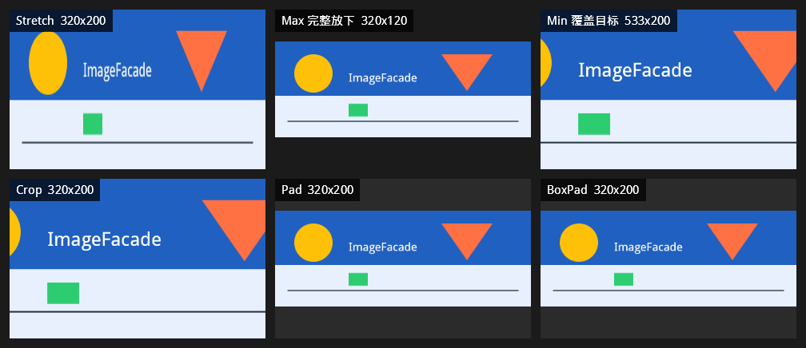
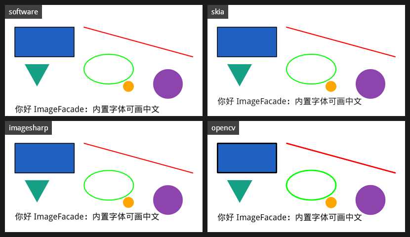
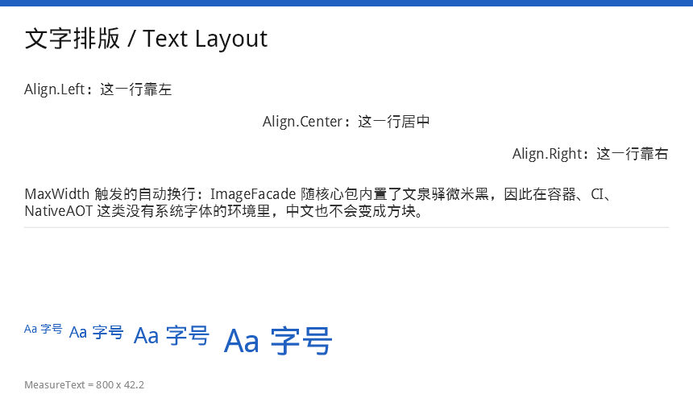
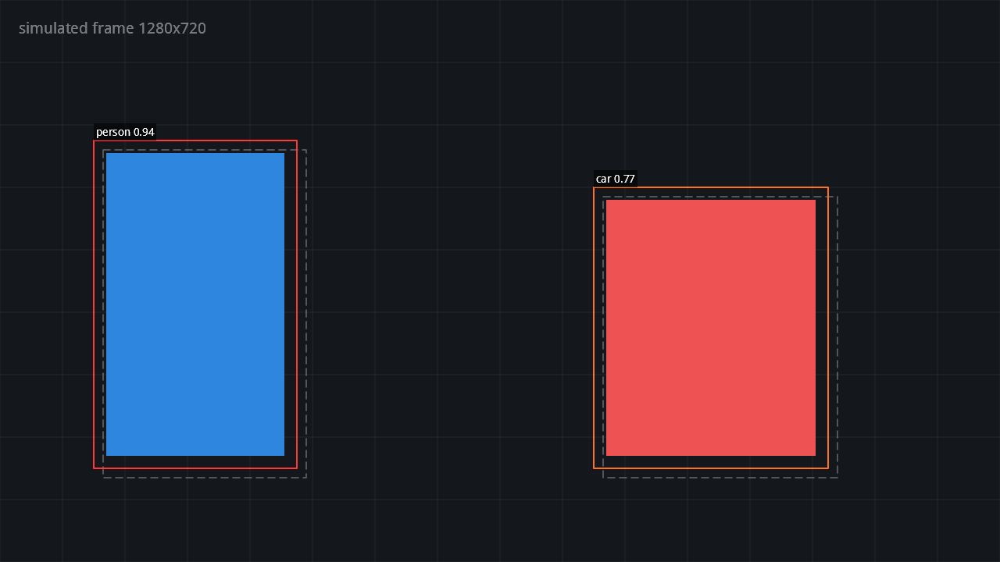
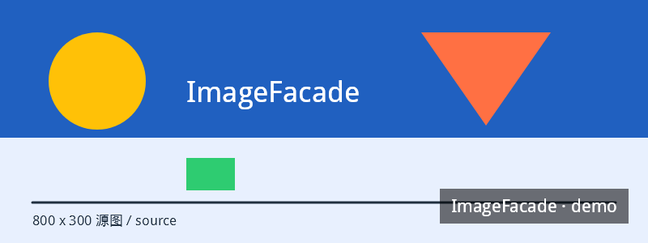
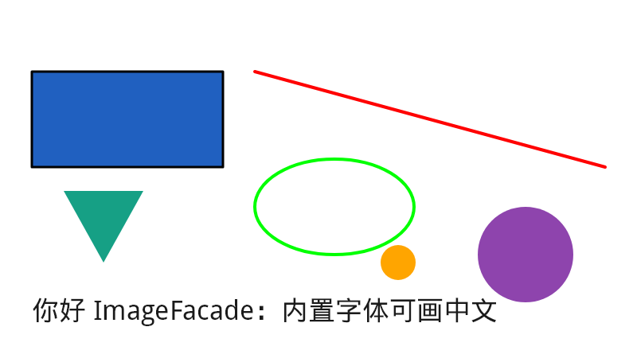
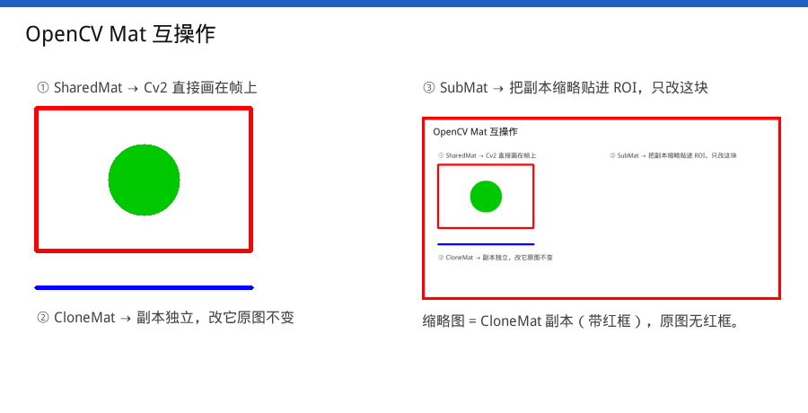

<div align="center">

# ImageFacade

**一套与后端无关的图像处理 API**。换一行构造代码，就能在 SkiaSharp / OpenCvSharp / ImageSharp / 纯托管软渲染之间切换，其余代码一个字都不用改。

<p>
  <a href="https://www.nuget.org/packages/Sevencat.ImageFacade"></a>
  <a href="https://www.nuget.org/packages/Sevencat.ImageFacade"></a>
  
  
  
  
</p>

<p>
  <a href="https://www.nuget.org/packages/Sevencat.ImageFacade">Sevencat.ImageFacade</a> ·
  <a href="https://www.nuget.org/packages/Sevencat.ImageFacade.SdcbSimdCodecs">SdcbSimdCodecs</a> ·
  <a href="https://www.nuget.org/packages/Sevencat.ImageFacade.SkiaSharp">SkiaSharp</a> ·
  <a href="https://www.nuget.org/packages/Sevencat.ImageFacade.ImageSharp">ImageSharp</a> ·
  <a href="https://www.nuget.org/packages/Sevencat.ImageFacade.ImageSharp2">ImageSharp2</a> ·
  <a href="https://www.nuget.org/packages/Sevencat.ImageFacade.OpenCvSharp">OpenCvSharp</a> ·
  <a href="https://www.nuget.org/packages/Sevencat.ImageFacade.OpenCvSharp5">OpenCvSharp5</a>
</p>

</div>



---

## 为什么

图像处理的库很多，但它们的 API 互不兼容：换一个后端，`Resize`、画笔、文字排版、像素布局全都要重写一遍。项目一旦因为许可证、平台、部署形态（容器 / AOT / 无原生依赖）不得不换库，改动面通常是整个业务层。

ImageFacade 把这层差异收在 `IImageBackend` 后面：

- **调用方只依赖一个门面**：`ImageEngine` + `FacadeImage`。
- **后端互不兜底**：支持的能力原生执行，不支持的直接抛 `FeatureNotSupportedException`（带后端名与能力名）。没有隐藏的性能悬崖，也没有"看起来一样其实不一样"的输出。
- **六个工程覆盖三个主版本组合**：SkiaSharp 4、OpenCvSharp 4/5、ImageSharp 2/3，一份源码，不复制实现。
- **中文开箱可用**：核心包内置文泉驿微米黑，容器 / CI / NativeAOT 环境下不需要准备任何字体。

## 特性

| | |
|---|---|
| **绘制** | 点、线、折线、矩形、椭圆、多边形，描边与填充；虚线；半透明叠加 |
| **文字** | 字号 / 颜色 / 字体；左中右对齐；`MaxWidth` 自动换行；`MeasureText` 与绘制使用同一套排版 |
| **缩放** | `Stretch` / `Max` / `Min` / `Crop` / `Pad` / `BoxPad` 六种模式，一次性完成"缩放 + 补边 / 裁切" |
| **像素互操作** | `Bgra32` / `Bgr24` / `Rgb24` / `Gray8` 直接进出，支持任意 `stride`，不强制行连续 |
| **原生句柄** | OpenCV 后端可拿底层 `Mat`：`SharedMat()` 共享、`SubMat()` 取 ROI 视图、`CloneMat()` 深拷贝（**内部是 BGRA**，见下文边界说明） |
| **检测流水线** | letterbox + 坐标反算、NCHW/NHWC 张量化、池化缓冲、NMS、检测框与标签绘制 |
| **加载** | `Load(path)` 走只读内存映射，不再 `File.ReadAllBytes` 出等长数组；文件长度在映射前就校验 |
| **半透明检测** | 加载时顺手查一次"图里真有半透明像素吗"（`HasTransparency`）；可关掉、也可自己按需重算；已知不透明时 JPEG / BMP 编码省掉合成背景 |
| **异步** | 加载 / 保存 / 编码有 `Async` 版本；绘制保持同步（微秒级，包一层 Task 只会更慢） |
| **AOT** | 核心与软后端声明 `IsAotCompatible`，无反射、无动态代码生成 |

## 安装

七个包都已发布到 [nuget.org](https://www.nuget.org/packages/Sevencat.ImageFacade)，当前版本 `0.3.0`。

```xml
<!-- 核心包永远要引，再按需加一个后端 -->
<PackageReference Include="Sevencat.ImageFacade" Version="0.3.0" />
<PackageReference Include="Sevencat.ImageFacade.SkiaSharp" Version="0.3.0" />
```

后端包已带上对应三方库的依赖，不需要重复声明 `SkiaSharp` / `OpenCvSharp4` / `SixLabors.ImageSharp`。

### 版本与兼容

**每个包独立发版**，不强制"七个包同进同退"（`0.3.0` 是当前七个包统一的基线，此前的软后端曾单独走 `0.1.x`）：

| 包 | 版本线 |
|---|---|
| `Sevencat.ImageFacade`（核心） | 独立；**patch / minor 只做加法**，不破坏已发布的公开 API |
| 各后端（SkiaSharp / ImageSharp / ImageSharp2 / OpenCvSharp / OpenCvSharp5 / SdcbSimdCodecs） | 各自独立，可以只升其中一个 |

三条约定：

1. **后端依赖核心只用下界**：nuspec 里写的是 `Sevencat.ImageFacade >= X.Y.Z`，不是精确版本。
2. **核心前向兼容时，后端不用重发**：核心只做"加 API / 修 bug"的兼容改动时，把它升到更高的 `X.Y.Z+n`，现有后端包照常工作；只有核心做了不兼容改动（升主版本）才需要后端重新发版对齐。
3. **只升后端也安全**：后端只用到核心的旧 API，升级某个后端不会连累核心。

各包的实际版本以 nuget 页面为准；本文安装示例里的 `Version="0.3.0"` 是当前统一基线的取值。

| 包 | 后端类 | 三方库 | 说明 |
|---|---|---|---|
| [`Sevencat.ImageFacade`](https://www.nuget.org/packages/Sevencat.ImageFacade) | — | 无 | 核心：契约 + 路由 + 排版 + 内置字体 + Pipeline |
| [`Sevencat.ImageFacade.SdcbSimdCodecs`](https://www.nuget.org/packages/Sevencat.ImageFacade.SdcbSimdCodecs) | `SoftwareBackend` | `Sdcb.SimdCodecs.Abstractions` 2.0 | 纯托管，无原生依赖，**仅 `net10.0`**；编解码按需接入，见下 |
| [`Sevencat.ImageFacade.SkiaSharp`](https://www.nuget.org/packages/Sevencat.ImageFacade.SkiaSharp) | `SkiaBackend` | `SkiaSharp` 3.119.1 | 编译目标 3.x，**可提升到 4.x**（4.x 兼容 3.x） |
| [`Sevencat.ImageFacade.ImageSharp`](https://www.nuget.org/packages/Sevencat.ImageFacade.ImageSharp) | `ImageSharpBackend` | `ImageSharp` 3.1 | 纯托管，格式最全 |
| [`Sevencat.ImageFacade.ImageSharp2`](https://www.nuget.org/packages/Sevencat.ImageFacade.ImageSharp2) | `ImageSharpBackend` | `ImageSharp` 2.1 | 同上，2.x 分支 |
| [`Sevencat.ImageFacade.OpenCvSharp`](https://www.nuget.org/packages/Sevencat.ImageFacade.OpenCvSharp) | `OpenCvBackend` | `OpenCvSharp4` 4.13 | 内部 BGRA，API 层统一 RGBA |
| [`Sevencat.ImageFacade.OpenCvSharp5`](https://www.nuget.org/packages/Sevencat.ImageFacade.OpenCvSharp5) | `OpenCvBackend` | `OpenCvSharp5` 5.0 | 同上，5.x 分支 |

无后缀 = 当前主版本；带数字 = 指定的另一主版本。**同一进程只能绑定一个三方库主版本**，所以 `Sevencat.ImageFacade.ImageSharp` / `...ImageSharp2` 只能二选一。

原生库按 RID 由应用侧引用，适配包不钉死 RID：

```xml
<PackageReference Include="SkiaSharp.NativeAssets.Win32" Version="3.119.1" />
<!-- OpenCV 必须设 RuntimeIdentifier -->
<RuntimeIdentifier>win-x64</RuntimeIdentifier>
<PackageReference Include="OpenCvSharp4.runtime.win" Version="4.13.0.20261107" />
```

### 软后端：编解码按需接入

`Sevencat.ImageFacade.SdcbSimdCodecs` **不内置任何编解码器**——它只带 `Sdcb.SimdCodecs.Abstractions`（编解码抽象）和自绘渲染层。要读写什么格式，就引哪几个 `Sdcb.SimdCodecs.Xxx` 包，然后在启动时注册一次。

这样设计是因为格式是可选项：只存 PNG 的服务不该把 WebP / TIFF / JPEG 2000 的代码一起扛进包和内存。注册表是**进程级静态**的，启动时填一次，之后所有 `SoftwareBackend` 实例共享。

| 需要 | 引哪个包 |
|---|---|
| PNG | `Sdcb.SimdCodecs.Png` |
| JPEG | `Sdcb.SimdCodecs.Jpeg` |
| BMP | `Sdcb.SimdCodecs.Bmp` |
| GIF | `Sdcb.SimdCodecs.Gif` |
| WebP | `Sdcb.SimdCodecs.Webp` |
| TIFF | `Sdcb.SimdCodecs.Tiff` |
| ICO / CUR | `Sdcb.SimdCodecs.Ico` |
| QOI / Netpbm | `Sdcb.SimdCodecs.Qoi` / `Sdcb.SimdCodecs.Pnm` |
| JPEG 2000 / JBIG2（PDF 场景） | `Sdcb.SimdCodecs.Jpeg2000` / `Sdcb.SimdCodecs.Jbig2` |
| HEIF / HEIC（手机照片） | `Sdcb.SimdCodecs.Heif`，**HEVC 有专利**，需自行评估后再用 |

初始化：在 `Program.cs` 开头或 `[ModuleInitializer]` 里注册一次（`ImageFormat` 是门面的 `ImageFacade.ImageFormat`）：

```csharp
using ImageFacade.Backends;
using Sdcb.SimdCodecs.Bmp;
using Sdcb.SimdCodecs.Jpeg;
using Sdcb.SimdCodecs.Png;

// 一次注册 = 解码器 + 编码器；第三个参数把门面的 EncodeRequest 映射成该格式的选项
ImageBackendBase.RegisterCodec(
    ImageFormat.Png,
    PngImageDecoder.Registration,
    PngImageEncoder.Registration);

ImageBackendBase.RegisterCodec(
    ImageFormat.Jpeg,
    JpegImageDecoder.Registration,
    JpegImageEncoder.Registration,
    request => new JpegEncodeOptions { Quality = Math.Clamp(request.Quality, 1, 100) });

ImageBackendBase.RegisterCodec(
    ImageFormat.Bmp,
    BmpImageDecoder.Registration,
    BmpImageEncoder.Registration,
    _ => new BmpEncodeOptions());
```

要点：

- **只注册需要的**：`RegisterDecoder` / `RegisterEncoder` 可以只注册一半（例如服务只产出 JPEG、不读图）。
- **没注册的格式**：`CanDecode` / `CanEncode` 返回 `false`，`Load` / `Save` 抛 `FeatureNotSupportedException`；**绘制、Resize、文字与编解码无关，照常可用**——完全不注册也能当纯渲染后端。
- **别把两个 `ImageFormat` 一起 `using`**：门面的是 `ImageFacade.ImageFormat`，`Sdcb.SimdCodecs.Abstractions` 里也有一个同名的，冲突时用别名。
- **注册是幂等且线程安全的**，但请在启动阶段做一次，别放进请求路径。
- **AOT 不受影响**：注册表就是普通静态字典，没有反射。

### 背后的编解码库：Sdcb.SimdCodecs

软后端的编解码全部来自 [Sdcb.SimdCodecs](https://github.com/sdcb/SimdCodecs)（MIT）。选它是因为它同时满足了"快""准""零原生依赖"三件在容器 / AOT 场景里很难兼得的事：

- **纯托管、零原生依赖**：Windows / Linux / macOS、NativeAOT、browser-wasm 都能跑，同一份输入在所有目标上输出一致——这对"软后端 = 确定性回退基准"很关键，不会因为换了台机器或镜像，同一张图的字节就变了。
- **SIMD 加速，但不是只有 SIMD**：AVX2 / SSE / AdvSimd 三条路径 + 标量回退，老 CPU 也能正确跑。
- **速度和原生库同级**：JPEG 解码 0.82× libjpeg-turbo、PNG 解码 0.88× libpng、WebP 解码 0.53–0.88× libwebp（同机单线程，低于 1.00× 表示更快）。
- **结果是精确的**：WebP 解码与 libwebp 逐字节一致，PNG 与无损 JPEG 2000 位精确；不会出现"换库后图看起来一样、像素对不上"。
- **低分配**：可以直接解码进你自己的缓冲区，任意像素布局与任意行 stride（`ImageBackendBase` 走的正是这条路径），JPEG 解码 0 托管分配。

## 30 秒上手

```csharp
using ImageFacade;
using ImageFacade.SkiaSharp;

using var engine = new ImageEngine(new SkiaBackend());
using var image  = engine.Load("in.jpg", new LoadOptions { AutoOrient = true });

image.Resize(new ResizeOptions
     {
         Width = 800, Height = 600,
         Mode = ResizeMode.Max,
         Sampler = Sampler.Lanczos3,
     })
     .DrawLine(new PointF(20, 20), new PointF(300, 20), Rgba32.Red, width: 3)
     .DrawText("你好 ImageFacade", new PointF(40, 240), new TextStyle
     {
         Font = FontRef.BuiltIn,
         Size = 36,
         Color = Rgba32.FromHex(0x1A1A1A),
         MaxWidth = 720,
         Align = TextAlign.Left,
     });

image.Save("out.png", new SaveOptions { CompressionLevel = 6 });
```

换后端只改一行：

```csharp
// using ImageFacade.OpenCvSharp; / using ImageFacade.SdcbSimdCodecs;
using var engine = new ImageEngine(new OpenCvBackend());
using var engine = new ImageEngine(new SoftwareBackend());    // 纯托管，无原生依赖（编解码要先注册，见上）
```

## 截图

**同一段代码，四个后端**（software / skia / imagesharp / opencv）：



| 文字排版 | 检测流水线 |
|---|---|
|  |  |

| 水印叠加 | 基础绘制 |
|---|---|
|  |  |

| OpenCV Mat 互操作 |
|---|
|  |

以上图片全部由 `samples/ImageFacade.Samples` 生成（`dotnet run` 输出到 `docs/images/`），可以直接改代码看效果。检测流水线那张里的**虚线框是 NMS 抑制掉的候选框**，实线是保留的。

## Resize 六模式

上图（顶部那张）就是同一张 800×300 源图跑六种模式的结果：

| 模式 | 行为 | 输出尺寸 |
|---|---|---|
| `Stretch` | 直接拉伸，不保持比例 | 目标尺寸 |
| `Max` | 等比缩放到**完全放进**目标框 | 缩放后尺寸 |
| `Min` | 等比缩放到**覆盖**目标框 | 缩放后尺寸 |
| `Crop` | 等比铺满后居中裁切 | 目标尺寸 |
| `Pad` | 等比放进后补边 | 目标尺寸 |
| `BoxPad` | 同 `Pad`，但**只缩小不放大**（源图比目标框小时原尺寸居中补边） | 目标尺寸 |

`Max` / `Min` 的命名沿用 .NET 与 SixLabors 的习惯：`Max` 是"最大尺寸不超过目标框"。

## 检测流水线

`ImageFacade.Pipeline` 在核心包内，不依赖任何推理库：它只负责"把帧变成模型输入"和"把模型输出画回帧"，中间跑什么模型由你决定。

```csharp
using ImageFacade;
using ImageFacade.Pipeline;

// 1) letterbox：源图不变，返回新图 + 反算几何
using FacadeImage padded = frame.Apply(640, 640, out LetterboxInfo info);
// 1280x720 -> 640x640：info.Scale = 0.5，info.PadTop = 140

// 2) 张量化：NCHW + RGB + 归一到 0..1，写入池化缓冲
var options = new TensorOptions { Width = 640, Height = 640 };
using TensorBuffer tensor = TensorBuffer.Rent(640 * 640 * 3);
frame.ToTensor(options, tensor.Span, out _);
// tensor.Memory 可直接交给 onnxruntime

// 3) 假设模型返回了模型坐标下的框
Span<Detection> detections = /* 从模型输出解码 */;

// 4) NMS：原地抑制，返回保留数量
int kept = Nms.Suppress(detections, iouThreshold: 0.45f);

// 5) 反算回源图坐标，再画到**源帧**上
var onSource = new Detection[kept];
for (int i = 0; i < kept; i++)
{
    Detection detection = detections[i];
    onSource[i] = new Detection(info.ToSource(detection.Box), detection.Label, detection.Score)
    {
        ClassId = detection.ClassId,
    };
}

frame.DrawDetections(onSource);
```

要点：

- `Apply` **不改源图**，所以画框可以直接画在源帧上，坐标不用二次换算。
- `LetterboxInfo.ToSource` 是唯一的反算入口；手写 `(x - pad) / scale` 容易把顺序写反。
- 张量缓冲用 `TensorBuffer.Rent` 池化：640×640×3 是 4.9 MB，每帧新分配会直接进 LOH。
- `Nms.Suppress` 原地重排，有效段是 `detections[..kept]`，结果与输入顺序无关；`Nms.Select` 返回原数组下标。
- `DrawDetections` 只是默认排版，标签宽度走 `MeasureText`，与当前后端自洽；要别的排版就自己循环 `DrawRectangle` + `FillRectangle` + `DrawText`。
- OpenCV 后端不支持半透明形状：`DetectionStyle.LabelBackground` 默认的 `(0,0,0,160)` 会抛 `FeatureNotSupportedException`，需要改成不透明色。

## 视频帧：原生内存进出

```csharp
// 指针来自 ffmpeg 的 avFrame->data[0] 与 linesize[0]（或相机缓冲），不先转 RGBA。
IntPtr pixels = frameDataPtr;
int    stride = linesize;

using var frame = engine.FromPixels(pixels, width, height, stride, PixelFormat.Bgr24);

frame.DrawRectangle(new RectF(100, 80, 220, 160), Rgba32.Lime, width: 2);

// 直接写进 Avalonia 的 WriteableBitmap 锁帧内存
frame.CopyPixelsTo(fb.Address, fb.RowBytes, PixelFormat.Bgra32);
```

`stride` 由调用方给出，按行处理、不要求连续；格式缺省是 `Rgba32`，`Bgr24` / `Bgra32` / `Rgb24` / `Gray8` 需显式指定。

> **关于通道顺序**：门面层没有"这个图是 RGB 还是 BGR"的概念，`Rgba32`、`PixelFormat.Rgba32`（默认）、`GetPixel`、`CopyPixels` 全是 RGBA 语义。后端内部怎么存是它自己的事——OpenCV 用 `CV_8UC4`（BGRA），Skia 用 `Rgba8888 Premul`，都与调用方无关。
>
> 唯一要显式声明顺序的地方是 `FromPixels(..., PixelFormat.Bgr24)` 这类入参：**你告诉门面源缓冲是什么格式**，它负责转换。反过来 `CopyPixels(PixelFormat.Bgr24)` 也一样。
>
> 代价是 OpenCV 后端不做零拷贝包装（BGRA↔RGBA 必须逐行换通道），`FromPixels` 会拷贝一次；Skia / 软后端才能直接接管外部缓冲。OpenCV 为什么必须保持 BGRA、拿 `Mat` 出去后哪些函数要自己换通道，见下文 **[OpenCV 内部是 BGRA：哪些函数转、哪些要你自己处理](#opencv-内部是-bgra哪些函数转哪些要你自己处理)**。

### 像素出入只有一条路

**校验在门面做一次，后端只负责"按 stride 逐行搬运"。**

- `FromPixels` / `CopyPixelsTo` 的尺寸、`bytesPerPixel`、`stride` 下界、缓冲区长度（`(height-1)*stride + rowBytes`，`long` 计算防溢出）全部由门面统一校验；后端 `ImportPixels` / `TryCopyPixels` 拿到的一定是"已验证过"的参数。
- 输入不是 `Rgba32` 时，门面先用 `PixelConverter` 归一成规范 RGBA32（`stride = width * 4`），再交给后端——所以**每个后端只需要实现一种像素布局**，不用为 BGR / BGRA / Gray 各写一套分支。
- OpenCV 后端因此只有一份 `SwapRedBlue`（RGBA32 ↔ BGRA）：通道交换是对合运算，**导出与导入共用同一份实现**，不会出现"两个方向各写一遍、只修了其中一个"的情况，也天然覆盖 `Mat.step > cols*4` 的对齐填充和外部缓冲的非紧凑 stride。

## OpenCV 内部是 BGRA：哪些函数转、哪些要你自己处理

> **先记住这句话：OpenCV 后端的帧内部就是一块 `CV_8UC4`、字节序为 B/G/R/A 的 `Mat`。**
>
> 这是四个后端里**唯一的例外**，而且是刻意的：`Cv2.ImDecode` / `Cv2.ImEncode` 只认 BGR / BGRA，内部若改存 RGBA，**每次打开和保存都要多一次全图转换**；现在的代价只落在 `FromPixels` / `CopyPixelsTo` 这一对边界上（它们本来就要按 stride 逐行搬运，顺带换通道）。所以不要试图把它"统一"成 RGBA。
>
> 但要注意，这**不是**说调用方也要跟着用 BGRA——只要走门面 API，看到的永远是 RGBA 语义。边界只在"直接拿 `Mat`"的那一刻出现。

| 后端 | 内部像素布局 | 说明 |
|---|---|---|
| Skia | `Rgba8888` + `Premul` | 原生 RGBA |
| ImageSharp | `Image<Rgba32>` | 原生 RGBA |
| 软后端 | 预乘 `Rgba32` | 原生 RGBA |
| **OpenCV** | **`CV_8UC4` BGRA** | **唯一例外**，因为 OpenCV 编解码只认 BGR/BGRA |

一句话记忆：**过门面 API = RGBA 语义；直接摸 `Mat` = BGRA 字节序。**

### 门面已经替你转了（按 RGBA 写，不用管 BGRA）

| 你用 | 门面做了什么 | 你要做什么 |
|---|---|---|
| `GetPixel(x, y)` | 读 BGRA 后换回 R/G/B | 无 |
| `CopyPixelsTo(buf, stride)` / `CopyPixels()`（默认 `Rgba32`） | 逐行 BGRA → RGBA | 无 |
| `CopyPixelsTo(..., PixelFormat.Bgra32)` | 先转 RGBA，再按声明格式写成 BGRA | 无（按声明的格式读） |
| `FromPixels(span / ptr, ..., 默认 Rgba32)` | RGBA → BGRA 写进 `Mat` | 无 |
| `FromPixels(..., PixelFormat.Bgr24 / Bgra32 / Rgb24 / Gray8)` | 核心先归一成规范 RGBA32，后端再换通道 | 无（只要格式声明对） |
| `AcquirePixels()` / `PixelLease.Pixels` | 交给你的是规范 RGBA32，回写时再换回 BGRA | 无 |
| `DrawLine` / `FillRectangle` / `DrawText` / `Clear` 的 `Rgba32` 参数 | 后端 `ToScalar` 内部组装成 B/G/R/A 的 `Scalar` | 无 |
| `Save` / `Encode` / `Load` / `Decode` | 后端内部 `ImEncode` / `ImDecode` 直接吃 BGRA | 无 |
| `Resize` / 六种模式 / `DrawDetections` / `Apply` | 与通道顺序无关 | 无 |

### 摸到 `Mat` 之后要你自己处理

`SharedMat()` / `SubMat()` / `CloneMat()` 交出来的是**原始 BGRA `Mat`**，门面不再做任何转换：

| 你调用的 OpenCV API | 它期待的顺序 | 是否需要处理 |
|---|---|---|
| `Cv2.Rectangle` / `Line` / `Circle` / `Ellipse` / `FillPoly` 的颜色 | `Scalar` 即 B,G,R,A | **要**：红色是 `new Scalar(0, 0, 255, 255)`，不是 `(255, 0, 0, 255)` |
| `Cv2.ImWrite` / `ImEncode` | BGRA | 不用，正好对 |
| `Cv2.CvtColor(..., BGR2Gray / BGRA2BGR / BGR2RGB)` | BGR 系列 | 不用，`Mat` 就是 BGRA |
| `Cv2.CvtColor(..., RGB2Gray / RGBA2BGR / RGBA2RGB)` | 期望 RGBA | **要**：先 `BGRA2RGBA` 或用 BGR 系列 |
| DNN / onnxruntime 的 NCHW 输入 | 看模型（多为 BGR 或 RGB） | **要**：`CvtColor(BGRA2BGR)` 或 `BGRA2RGB` |
| `Mat.At<Vec4b>(y, x)`、直接读 `Mat.Data` | 字节序 B,G,R,A | **要**：`Item0=B, Item1=G, Item2=R, Item3=A` |
| 自己 `new Mat`（或从别处解码来的）贴回图片 | 目标区域是 BGRA | **要**：手头是 RGBA 时先 `CvtColor(RGBA2BGRA)`，否则红蓝对调 |
| `wrap: true` 零拷贝 | 只有 RGBA 能和规范像素对齐 | OpenCV 不做包装，`FromPixels` 一定拷贝一次 |

> 另外两点：`Mat.Type()` 只有 `CV_8UC4`，OpenCV 本身不区分 RGBA / BGRA，顺序纯靠约定——所以门面内部换通道、外部按 BGRA 用，两条路都必须心里有数。`SharedMat` / `SubMat` 返回的 `Mat` 归门面所有：不要 `Dispose`、不要跨线程、图片释放后不要再碰。

## OpenCV Mat 互操作

把上面那块 BGRA `Mat` 交给 `Cv2`、DNN 或标定代码，不必绕 `CopyPixels` 转一趟缓冲：

```csharp
using ImageFacade.OpenCvSharp;
using OpenCvSharp;

Mat shared = image.SharedMat();                              // 后端保存的 Mat，不复制
// 注意 Scalar 是 BGRA 顺序：这个画出来是红色
Cv2.Rectangle(shared, new Rect(10, 10, 100, 60), new Scalar(0, 0, 255, 255), 3);

using Mat roi = image.SubMat(100, 40, 200, 120);             // ROI 视图，共享像素
Cv2.GaussianBlur(roi, roi, new Size(5, 5), 0);               // 只影响这 200x120

using Mat copy = image.CloneMat();                           // 深拷贝，改它不影响原图
```

| 方法 | 内存 | 用途 |
|---|---|---|
| `SharedMat()` | 共享 | 把整帧交给 OpenCV（`Cv2.*`、DNN 输入、`ImWrite`） |
| `SubMat(x, y, w, h)` / `SubMat(Rect)` | 共享 | 只处理一块区域；写进去就是写原图 |
| `CloneMat()` | 复制 | 要一份能随便改、能脱离图片生命周期的副本 |

- 通道顺序是 **BGRA**（`Scalar` 的 v0/v1/v2 = B/G/R，v3 = alpha，不写 v3 会画成透明）——完整的"哪些函数门面转了、哪些要自己处理"见上一节的两张表。
- `SharedMat` / `SubMat` 返回的 `Mat` 归门面所有：不要 `Dispose`、不要跨线程、图片释放后不要再碰；`CloneMat` 的副本归调用方，自己 `using`。
- 只有 `OpenCvBackend` 的帧能这样拿，其他后端调用抛 `InvalidOperationException`；与后端无关的像素级互操作用 `CopyPixels` / `AcquirePixels`。


## 后端能力矩阵

`✓` 原生支持；`✗` 不支持，调用时抛 `FeatureNotSupportedException`（消息含后端名与能力名）。

| 能力 | Skia | ImageSharp | OpenCV | 软后端 |
|---|:---:|:---:|:---:|:---:|
| Resize / 六种模式 | ✓ | ✓ | ✓ | ✓ |
| 点 / 线 / 折线 / 矩形 / 椭圆 / 多边形 | ✓ | ✓ | ✓ | ✓ |
| 半透明形状（`color.A < 255`） | ✓ | ✓ | **✗** | ✓ |
| 虚线（`StrokeStyle.DashPattern`） | ✓ | ✓ | **✗** | ✓ |
| 文字（含中文） | ✓ | ✓ | ✓ | ✓ |
| 半透明文字 | ✓ | ✓ | ✓ | ✓ |
| 解码格式 | PNG/JPEG/BMP/GIF/WebP/ICO | PNG/JPEG/BMP/GIF/WebP/TIFF | PNG/JPEG/BMP/WebP | 按注册（Sdcb 格式包） |
| 编码格式 | PNG/JPEG/WebP | PNG/JPEG/BMP/GIF/WebP/TIFF | PNG/JPEG/BMP/WebP | 按注册（Sdcb 格式包） |
| NativeAOT | 已声明兼容 | 未声明 | 不支持 | 已声明兼容 |
| 原生依赖 | SkiaSharp RID 包 | 无 | OpenCV RID 包 | 无 |

OpenCV 后端没有 alpha 混合与 stroke pattern——这两条限制来自 OpenCV 的 drawing 函数本身，不是适配实现的选择。需要半透明叠加或虚线时换 Skia / ImageSharp / 软后端。

OpenCV 解码后会把输入统一成 **8 位 BGRA**：灰度、灰度+alpha、无 alpha 的图都补成 4 通道（缺 alpha 补 255），**16 位 PNG 按 `1/257` 归一**（`65535 → 255`，直接截断会饱和成一片白）。这样"每像素固定 4 字节"的约定对所有输入都成立。

**跨后端不保证逐像素一致**：抗锯齿、字体栅格化、缩放核的实现各不相同。需要确定性输出时把软后端当主后端。

## 中文与字体

- 核心内置文泉驿微米黑（`FontRef.BuiltIn`），**没有系统字体也能画中文**；容器 / CI / AOT 场景不需要额外准备字体。
- 系统字体族（`FontRef.Family(...)`）只有 Skia 与 ImageSharp 支持；OpenCV 与软后端没有系统字体管理器，会退回内置字体。
- 自备字体：`Font.Load*` 拿到实例后塞进 `TextStyle.FontFace`，可跨多次绘制复用。
- `FontRef.FromData(...)` / `FontRef.FromFile(...)` 在 Skia 后端**按引用缓存**（同一 `FontRef` 只解析一次），
  且不会长期占用字体文件句柄——注册后文件可以照常替换或删除。

## 解码尺寸上限（防解压炸弹）

`Load` / `LoadAsync` 默认拒绝超过 **1 亿像素**（约 400 MB RGBA）的图像：一个 20 KB 的 PNG 声明
30000×30000 时，不会先分配 3.6 GB 再报错。

```csharp
// 默认：超过 1 亿像素抛 ImageSizeLimitExceededException
using var image = engine.Load(untrustedBytes);

// 允许更大的可信输入（0 = 不限制）
using var big = engine.Load(path, new LoadOptions { MaxPixels = 0 });
```

- 校验在**门面**做，四个后端一视同仁：能读到头部（PNG / JPEG / BMP / GIF / WebP / TIFF / QOI / PNM）
  就在**解码前**拒绝；读不到头部时才退化为解码后兜底。
- `ImageSizeLimitExceededException.Width` / `Height` / `MaxPixels` 给出当时的数值；
  它和"图损坏"是两类异常，方便映射成 413 与 400。
- `ImageEngine.Create` / `FromPixels` 不受这个上限约束——那里的尺寸来自你的代码，不是外部输入。
- 只限**像素数**：像素少但字节多的输入（高熵图片、被刻意放大的文件）由下面的字节上限管。

### 编码字节上限（流式加载）

`Load(Stream)` / `LoadAsync(Stream)` 读入的是**压缩后的字节**，这层有独立的开关
`LoadOptions.MaxEncodedBytes`。**默认 `0` = 不限制**，保持与旧版本一致——现有调用方不会因为升级
突然开始抛异常。

```csharp
// 只允许读入 8 MB 的编码数据；超出立刻停止读取并抛异常，不会把整个文件吞进内存
using var image = engine.Load(httpStream, new LoadOptions { MaxEncodedBytes = 8 * 1024 * 1024 });
```

- 累计读到的字节数超过上限就**停手**（缓冲最多长到"上限 + 1"），异常里的
  `MaxEncodedBytes` / `EncodedBytes` 给出上限与已读字节数；`Width` / `Height` / `MaxPixels` 为 0。
- 可寻址流会先按 `Length` 快速拒绝；这个值不可信（网络流常常乱报），所以读循环里仍然累计校验。
- `Load(path)` / `LoadAsync(path)` 走**只读内存映射**，长度在建立映射之前就知道，所以同样按这个上限**先拒后读**；
  空文件抛 `ArgumentException`，超过单块缓冲上限（约 2 GB，span 长度是 `int`）也抛 `ImageSizeLimitExceededException`。
- 已经拿到完整字节的 `Load(ReadOnlySpan<byte>)` / `Load(ReadOnlyMemory<byte>)` 不受它约束——
  内存都已经分配过了，拦不住也没有意义。
- 与 `MaxPixels` 是**两个独立维度**，各自挡一类输入，互不影响。

### 半透明像素（`HasTransparency`）

`Metadata.HasAlpha` 只是解码器声明的**通道能力位**——不透明 PNG 同样带 alpha 通道。要知道"图里到底有没有
alpha < 255 的像素"，看 `Metadata.HasTransparency`（`bool?`，`null` = 不知道）：

```csharp
using var image = engine.Load(bytes);                  // 加载时顺手查一次（默认开）
bool? translucent = image.Metadata.HasTransparency;

// 关掉自动检测：省掉那一次全图扫描，代价是加载后为 null
using var lazy = engine.Load(bytes, new LoadOptions { DetectTransparency = false });

// 之后自己按需重算：有结论直接返回，force: true 无视缓存重扫
bool? now = lazy.DetectTransparency();
```

- 三态：`true` 有半透明像素、`false` 确定全不透明、`null` 不知道。**`null` 不是 `false`**，两个方向的判断都要留兜底分支。
- 没有 alpha 通道的输入（JPEG）加载时直接定 `false`，一个字节都不扫。
- 绘制、缩放、裁剪之后结论会**失效**（置回 `null`）；`Clear(color)` 直接等于 `color.A < 255`。需要时再调 `DetectTransparency()`。
- 检测怎么走、慢不慢、有哪些坑，见文末 [半透明像素：判断依据、性能与注意事项](#半透明像素判断依据性能与注意事项)。

## 出错时

| 情况 | 异常 |
|---|---|
| 参数非法 | `ArgumentException` / `ArgumentOutOfRangeException` |
| 后端不支持该能力 | `FeatureNotSupportedException`（含后端名、能力名、替代建议） |
| 图像超过 `LoadOptions.MaxPixels` | `ImageSizeLimitExceededException` |
| 流读入超过 `LoadOptions.MaxEncodedBytes` | `ImageSizeLimitExceededException`（`Width` / `Height` 为 0） |
| 保存到文件失败 | `ImageSaveFailedException`（含 `Path`、`FileDeleted`，半截文件已删除） |
| 三方库内部失败 | `ImageBackendException`（保留 `InnerException`，含后端名） |
| 原生库缺失 | `ImageBackendException`（含安装提示，不是裸 `DllNotFoundException`） |

### `Save(path)` 失败时会删除目标文件

`Save` / `SaveAsync` 直接写目标路径（不做"临时文件 + 改名"）。失败时会把写了一半的文件删掉，
并抛 `ImageSaveFailedException`，消息里明确写着"已删除写了一半的目标文件"。

```csharp
try
{
    image.Save("out.jpg");
}
catch (ImageSaveFailedException ex)
{
    // ex.Path        目标路径
    // ex.FileDeleted true = 半截文件已删掉；false = 删除也失败，可能残留
    // ex.InnerException 真正的失败原因
}
```

**代价**：目标路径原有的文件在保存开始时就被截断，失败后**不会恢复**。
需要保留原件就自己先备份，或改用 `Encode()` 拿字节后自行落盘。

路由只有两档：后端 `Try*` 返回 `true` 就原生执行，返回 `false` 就抛错。**没有跨后端自动回退**，行为在调用点可见。

## 构建与测试

```powershell
dotnet build ImageFacade.slnx
dotnet test  ImageFacade.slnx          # win-x64
dotnet pack  ImageFacade.slnx -c Release -o artifacts/packages
```

- 测试按主版本拆分工程（同一进程只能绑一个三方库版本），OpenCV 测试工程需 `RuntimeIdentifier=win-x64`。
- v1 只在 **win-x64** 验收；Linux/macOS 只保证核心与纯托管后端可编译。
- CI 见 `.github/workflows/ci.yml`：Windows + .NET 10，跑 build → test → pack。

## 项目结构

```
src/
  ImageFacade/                     # 核心：契约 + 路由 + 排版 + 内置字体 + Pipeline
  ImageFacade.SdcbSimdCodecs/      # 软后端：ImgProcSharp 渲染层 + 可插拔编解码（只引 Abstractions）
  ImageFacade.SkiaSharp/           # SkiaSharp 3.119（编译目标，兼容 4.x）
  ImageFacade.ImageSharp/          # ImageSharp 3.x + Drawing 2.x
  ImageFacade.ImageSharp2/         # ImageSharp 2.x + Drawing 1.x（链接上一份源码）
  ImageFacade.OpenCvSharp/         # OpenCvSharp4
  ImageFacade.OpenCvSharp5/        # OpenCvSharp5（链接上一份源码）
tests/                             # 一后端一测试工程，共享测试源码
samples/ImageFacade.Samples/       # 示例 + README 截图生成器
docs/images/                       # 截图
```

## 半透明像素：判断依据、性能与注意事项

"这张图带不带 alpha 通道"和"这张图里到底有没有半透明像素"是两件事，混用会得到方向相反的错：

| | 含义 | 例子 |
|---|---|---|
| `Metadata.HasAlpha` | 解码器声明的**通道能力位** | 不透明 PNG（RGBA，但 α 全是 255）为 `true` |
| `Metadata.HasTransparency` | 图里**真的**存在 α < 255 的像素 | 同一张图是 `false` |

决定"能不能直接按不透明编码""要不要先把图合成到背景色"的，永远是后者。

### 结论从哪来

`AlphaProbe.TryDetect` 按顺序试两条路，都不通就返回 `null`，**绝不猜**：

1. **问后端**（`IImageBackend.TryGetTransparency`，默认接口方法返回 `false`）。四个内置后端都在自己已经持有的缓冲上
   零拷贝扫一遍，门面一个像素都不用搬：

   | 后端 | 怎么答 | 答不上来的条件 |
   |---|---|---|
   | Skia | `SKBitmap.GetPixels()` 直接读 premultiplied 像素的 alpha 字节 | 位图不是 `Rgba8888` / 像素指针为空 |
   | ImageSharp | `DangerousTryGetSinglePixelMemory` 扫 `Rgba32` | 像素被拆成多段内存（罕见） |
   | OpenCV | `Mat.Data` + `Step()` 按行扫 | `Mat` 不是 `CV_8UC4` |
   | 软后端 | `Canvas.IsFullyOpaque()` | — |

   答不上来就落到第 2 条，结果一样对，只是慢一点。
2. **借像素视图**（`TryAcquirePixels`）：ImageSharp / OpenCV 是零拷贝，Skia / 软后端会拷一份整图再扫——
   所以那两个后端才自己去实现第 1 条，正常走不到这里。

加载收尾（`ImageEngine.FinishLoad`）在 `LoadOptions.DetectTransparency`（默认 `true`）打开时调一次；
`HasAlpha == false` 的输入直接定 `false`，连后端都不问——这就是"平台已经做好了，什么都不用做"的那种情形。
之后由 `FacadeImage.DetectTransparency(bool force = false)` 按需重算：有结论直接返回，`force: true` 无视缓存。

### 结论什么时候失效

| 操作 | `HasTransparency` 变成 | 为什么 |
|---|---|---|
| `Load`（检测开） | `true` / `false` | 解码后扫一次 |
| `Load`（`DetectTransparency = false`） | `null` | 没查 |
| `Create(background)` | 背景色 `A < 255` | 来源已知 |
| `FromPixels(...)` | `null` | 你看得见的字节，门面不替你假设 |
| `Clear(color)` | `color.A < 255` | 整张图一个颜色 |
| 任意绘制（点 / 线 / 矩形 / 文字 / 贴图…） | `null` | 可能刚画进去半透明颜色或抗锯齿边 |
| `Resize` 的 `Stretch` | 原值 | 重采样权重和为 1，既不凭空产生也不消掉 alpha |
| `Resize` 的 `Pad` / `BoxPad` / `Crop` | 原值 `false` 且**真的补了**半透明边 → `true`，否则原值 | 只有补边能引入透明像素 |

绘制本身**不**顺手扫全图：一次 `DrawLine` 多花 0.3 ms 是不能接受的，这笔账留给真正需要答案的那次调用。
读到 `null` 时可以不管（它本身就是有效答案），也可以调一次 `DetectTransparency()`。

### 性能影响

量级参考（单核、顺序访存、x64；用来判断"要不要在意"，不是基准报告）：

| 场景 | 额外开销 |
|---|---|
| 后端直接回答（四个内置后端的常态） | 一遍全图**只读**扫描、零分配；1080p ≈ 0.2–0.4 ms，4K ≈ 1–1.5 ms |
| 退到 `TryAcquirePixels` 且该后端零拷贝（ImageSharp / OpenCV） | 同上，多一次 span 的借还，可忽略 |
| 退到 `TryAcquirePixels` 且该后端要拷贝（Skia / 软后端，正常不会发生） | 一次整图拷贝 + 扫描，1080p ≈ 1–2 ms 和一次 8 MB 分配 |
| 无 alpha 通道的输入（JPEG、BMP；Skia / OpenCV / 软后端还能识别三通道 PNG） | 0，连后端都不问 |
| 已知全不透明时的 JPEG / BMP 编码 | **省掉**"新建合成帧 + 整图拷贝 + 逐像素合成"，1080p ≈ 数 ms 加一次 8 MB 缓冲租借 |
| `DetectTransparency(force: true)` | 同第一行，每次调用都重扫 |

参照系：1080p 解码本身在毫秒到十几毫秒，一次扫描是它的几个百分点；扫描是纯读，比一次同尺寸 `memcpy` 还便宜
（不用写、不用分配）。而 JPEG / BMP 编码那边省下来的是"拷贝 + 混合 + 分配"，通常比扫描本身更贵。

**什么时候值得关掉**：

- 只读尺寸 / 元数据、批量出缩略图的流水线（图马上被缩放或丢弃，答案没人看）；
- 服务端处理 4K 以上的大图，每张多 1 ms 攒起来能看见；
- 明确知道输入全不透明（相机 JPEG、屏幕截图、自己刚合成过的图）。

关掉后唯一的**功能**代价是 JPEG / BMP 编码省不掉"合成背景色"那一段：输出字节完全一样，只是慢了；
其它行为不受影响（`null` 是合法状态，谁都不会把它当 `false` 用）。

### 注意事项

1. **三态，别当布尔用**。`null` 不是 `false`：`== true`（确定有透明）和 `== false`（确定全不透明）是两个独立结论，
   写成 `if (HasTransparency != false)` 会把"不知道"归到"有透明"那一类。
2. **别用 `HasAlpha` 顶替**。带通道的图绝大多数是全不透明的；反过来 `HasAlpha == false` 时 `HasTransparency`
   必定为 `false`（加载期直接短路，手动重算也只会得到 `false`）。
3. **缓存会跨操作失效**。别把加载时读到的 `bool` 存起来、隔几次绘制再用——那时它已经是 `null` 或别的值了。
4. **`force: true` 每次都全图重扫**，包括后端那条零拷贝路径。不要放进循环、不要每次 `Save` 前都调：
   编码前的 `AssumeOpaque` 会自动用上缓存，不需要你催。
5. **探测不出来会反复试**。后端既答不上来、`TryAcquirePixels` 也不可用（自定义后端没实现，或你根本关掉了像素访问）时，
   `DetectTransparency()` 返回 `null` 且**不写缓存**，每次调用都要重试一遍；高频路径上请自己缓存结果或直接关掉检测。
6. **手动改像素门面不知道**。`AcquirePixels()` 写回、`SharedMat()` 直接改 `Mat`，都不会让结论失效；
   用这类后门改完图，先 `DetectTransparency(force: true)` 再拿结论。
7. **`FacadeImage` 不是线程安全的**。`DetectTransparency` 会写 `ImageMetadata`，同一张图别并发调用；
   多线程各处理一张用 `Fork` 出来的副本。
8. **和 EXIF 方向无关**。旋转 / 翻转不改变"是否存在 α < 255 的像素"，`AutoOrient` 开与不开结论一致。
9. **探测本身无副作用**。不改像素、不改 `IsZeroCopy`、不留引用：`TryAcquirePixels` 借来的 lease 扫完就还，
   也不影响"零拷贝 / 共享内存"那条链路的语义。

## 文档

| 文件 | 内容 |
|---|---|
| [plan.md](plan.md) | 设计、公开 API、SPI、里程碑、验收标准、性能目标 |
| [planv2.md](planv2.md) | 三批加固：解码尺寸上限、`PixelLease` 幂等、像素搬运优化、`Save` 失败语义、NMS/张量化热路径（含实测数据与剩余清单） |
| [misc.md](misc.md) | 决策记录、许可证矩阵、逐库的坑、测试策略、已否决方案、落地记录（§Z） |
| [THIRD-PARTY-NOTICES.txt](THIRD-PARTY-NOTICES.txt) | 第三方组件与许可证清单 |

## 许可证

本仓库以 **Apache License 2.0** 发布，全文见 [LICENSE](LICENSE)。

第三方组件见 [THIRD-PARTY-NOTICES.txt](THIRD-PARTY-NOTICES.txt)。其中两条必须注意：

1. **SixLabors.ImageSharp** 自 2.0 起是 **Six Labors Split License**（不是 Apache-2.0）。本仓库只做 `PackageReference`，但一旦引用 `Sevencat.ImageFacade.ImageSharp` / `Sevencat.ImageFacade.ImageSharp2`，你的项目就直接依赖它。请自行确认授权条件；不适用时改用 Skia 或软后端。
2. **文泉驿微米黑** 随核心程序集以嵌入资源分发，采用 Apache-2.0 / GPLv3 双许可 + 字体嵌入例外，本仓库走 Apache-2.0 分支。声明见 [licenses/LICENSE-WenQuanYiMicroHei.txt](licenses/LICENSE-WenQuanYiMicroHei.txt)。
